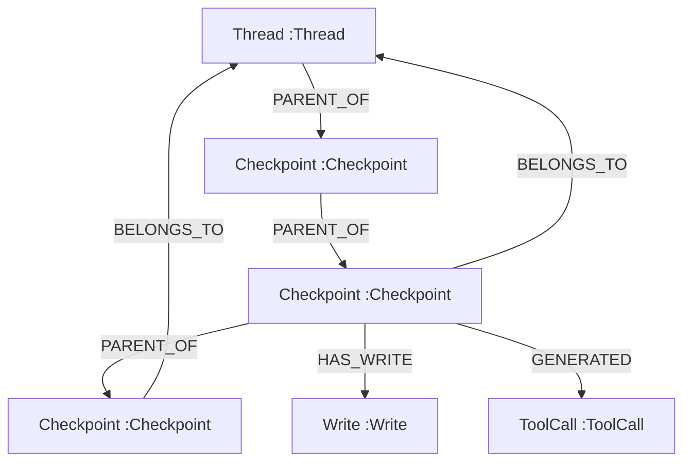

# RelateGraphSaver (`langgraph-checkpoint-relate`)

> **Embedded graph-native checkpoint and time-travel persistence engine for LangGraph, powered by Relate by Neo4j v1.0.0.**

[](https://www.python.org/)
[](https://opensource.org/licenses/MIT)
[](https://github.com/langchain-ai/langgraph)
[](https://neo4j.com/)

---

## Overview

Traditional checkpointing engines persist agent state into flat key-value pairs or relational rows (e.g., SQLite or Postgres). While functional for linear executions, modern multi-agent architectures are fundamentally **directed acyclic graphs (DAGs)**: they branch, fork, iterate in cycles, invoke external tools, and require time-travel debugging.

**RelateGraphSaver** bridges this gap by persisting LangGraph checkpoints directly into **Relate by Neo4j**, an embedded graph database engine supporting native Cypher queries, ACID Write-Ahead Logging (WAL), and single-file `.rl` persistence.

No Docker containers, external database servers, or network daemons are required. You get enterprise-grade graph storage, sub-millisecond local queries, and full Cypher traversal capabilities straight in your Python process.

---

## Key Features

- **Embedded Single-File WAL Persistence:** Stores all checkpoints, intermediate writes, and tool invocations in a zero-configuration `.rl` database file with atomic Write-Ahead Logging.
- **Native Cypher DAG Traversals:** Models threads, checkpoints, channel writes, and tool executions as first-class graph entities (`:Thread`, `:Checkpoint`, `:Write`, `:ToolCall`) linked by directional relationships (`:PARENT_OF`, `:BELONGS_TO`, `:HAS_WRITE`, `:GENERATED`).
- **Sandboxed In-Memory Time Travel:** Fork execution lineages from any historical checkpoint into an isolated `:memory:` database with `fork_in_memory()`, allowing exploratory branching without corrupting production files.
- **Terminal Execution Trees (`relate-dag tree`):** Visualize complex branching agent histories, parent-child lineages, and node states directly in your terminal with rich Unicode formatting.
- **Forensic Diagnostic Engine (`relate-dag forensics`):**
  - **Loop Detection (`loops`):** Detect infinite state oscillations and cyclical node patterns using Cypher cycle matching.
  - **Root-Cause Analysis (`trace-error`):** Pinpoint the exact antecedent tool call, channel write, or state mutation that caused an agent failure.
- **Human-in-the-Loop & Pending Writes:** Full native support for LangGraph `interrupt()` checkpoints and pending channel writes, allowing seamless state inspection and resumption.
- **Thread-Affinity Actor Concurrency:** Eliminates multi-threaded SQLite-style lock contention via a dedicated background actor queue (`RelateThreadProxy`), ensuring thread-safe Cypher execution.

---

## Installation

Install via `pip`:

```bash
pip install langgraph-checkpoint-relate
```

For local development and testing:

```bash
git clone https://github.com/relate-langgraph/langgraph-checkpoint-relate.git
cd langgraph-checkpoint-relate
pip install -e ".[dev]"
```

---

## Quickstart

Integrate `RelateSaver` into any standard LangGraph workflow with just two lines of code:

```python
from typing import Annotated
from typing_extensions import TypedDict

from langgraph.graph import StateGraph, START, END
from langgraph_checkpoint_relate import RelateSaver


# 1. Define agent state
class AgentState(TypedDict):
    query: str
    steps: list[str]
    count: int


# 2. Define workflow nodes
def plan_step(state: AgentState) -> dict:
    return {
        "steps": state.get("steps", []) + ["Plan formulated"],
        "count": state.get("count", 0) + 1,
    }


def execute_step(state: AgentState) -> dict:
    return {
        "steps": state.get("steps", []) + ["Execution completed"],
        "count": state.get("count", 0) + 1,
    }


# 3. Construct graph
workflow = StateGraph(AgentState)
workflow.add_node("plan", plan_step)
workflow.add_node("execute", execute_step)
workflow.add_edge(START, "plan")
workflow.add_edge("plan", "execute")
workflow.add_edge("execute", END)

# 4. Compile with RelateSaver checkpointer
with RelateSaver("checkpoints.rl") as checkpointer:
    app = workflow.compile(checkpointer=checkpointer)

    # 5. Execute with a persistent thread_id
    config = {"configurable": {"thread_id": "session-42"}}
    result = app.invoke({"query": "Analyze quarterly reports", "steps": [], "count": 0}, config)
    print("Final State:", result)

    # 6. Query checkpoint history natively
    history = list(checkpointer.list(config))
    print(f"Recorded {len(history)} checkpoints in graph.")
```

---

## CLI Reference (`relate-dag`)

`langgraph-checkpoint-relate` bundles `relate-dag`, a command-line tool for exploring and debugging agent execution graphs.

### 1. Execution Tree Visualization

Visualize the execution DAG for a specific thread, showing checkpoint IDs, node names, and parent-child linkages:

```bash
relate-dag tree <thread_id> --db checkpoints.rl
```

Output preview:
```text
Thread: session-42
└── Checkpoint: 1ef82a3c-b034-6c2e-8000-000000000001 (Node: __start__)
    └── Checkpoint: 1ef82a3c-b034-6c2e-8000-000000000002 (Node: plan)
        └── Checkpoint: 1ef82a3c-b034-6c2e-8000-000000000003 (Node: execute)
```

### 2. In-Memory Time-Travel Replay

Fork a thread at a historical checkpoint and spin up an isolated `:memory:` sandbox. Ideal for human-in-the-loop debugging and what-if exploration without mutating the on-disk `.rl` file:

```bash
# Fork from a historical checkpoint
relate-dag replay session-42 1ef82a3c-b034-6c2e-8000-000000000002 --db checkpoints.rl --branch session-42-debug
```

### 3. Forensic Diagnostics

#### Detect Agent Loops and State Oscillations

Multi-agent reflection and critique loops can spiral into infinite repetition. Detect repeating node cycles and their occurrence intervals:

```bash
relate-dag forensics loops session-42 --threshold 2 --db checkpoints.rl
```

#### Trace Failure Root Causes

When an agent fails, trace the backward causal graph to identify the earliest antecedent tool call or channel write that triggered the exception:

```bash
relate-dag forensics trace-error session-42 --db checkpoints.rl
```

---

## Architecture & Graph Schema

RelateGraphSaver translates agent execution dynamics into a property graph schema enforced by native Cypher unique constraints:



### Node Schema

| Label | Key Properties | Purpose |
| :--- | :--- | :--- |
| `:Thread` | `thread_id`, `created_at`, `updated_at` | Top-level execution context grouping related runs |
| `:Checkpoint` | `checkpoint_id`, `thread_id`, `checkpoint_ns`, `parent_checkpoint_id`, `node_name`, `step`, `state_dump`, `created_at` | Immutable snapshot of agent state and channel values |
| `:Write` | `write_id`, `thread_id`, `checkpoint_id`, `task_id`, `channel`, `idx`, `value_dump` | Pending or committed intermediate channel writes |
| `:ToolCall` | `tool_call_id`, `tool_name`, `args`, `status`, `error` | Forensic tracking of external tool executions |

### Relationship Schema

| Relationship | Direction | Description |
| :--- | :--- | :--- |
| `:BELONGS_TO` | `(:Checkpoint) -> (:Thread)` | Direct association between checkpoint and thread |
| `:PARENT_OF` | `(:Checkpoint) -> (:Checkpoint)` | Directed execution edge representing step progression |
| `:CHILD_OF` | `(:Checkpoint) -> (:Checkpoint)` | Reverse edge for rapid backward causal traversal |
| `:HAS_WRITE` | `(:Checkpoint) -> (:Write)` | Channel writes accumulated during a step |
| `:GENERATED` | `(:Checkpoint) -> (:ToolCall)` | External tool calls executed during node processing |

---

## Concurrency Model

Relate by Neo4j operates with strict file locks for single-writer consistency. To support concurrent LangGraph workers and web servers (such as FastAPI or Celery):

1. **Thread-Affinity Proxy:** All write and read operations are dispatched through `RelateThreadProxy`, a dedicated worker thread communicating over an internal thread-safe request/response queue.
2. **Actor Pattern:** Prevents cross-thread driver crashes and lock collisions while presenting a non-blocking asynchronous and synchronous interface to callers.
3. **Safe Context Management:** Use `with RelateSaver("path.rl") as saver:` to guarantee clean connection teardown and file lock release.

---

## Running the Example Application

An end-to-end multi-agent research agent with Human-in-the-Loop review is provided in `examples/research_agent.py`:

```bash
# Run the complete multi-agent workflow
python examples/research_agent.py --topic "Autonomous Agent Architecture" --db research_checkpoints.rl
```

---

## Testing

Run the automated test suite:

```bash
# Fast test suite (formatting, typing, unit & fast integration tests)
ruff check . && ruff format --check . && mypy src tests && python -m pytest -q -m "not slow"

# Full test suite including slow simulation benchmarks
python -m pytest -q
```

---

## License

This project is licensed under the MIT License. See [LICENSE](LICENSE) for details.
