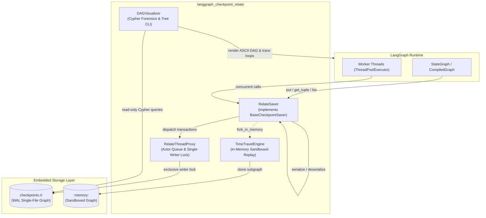
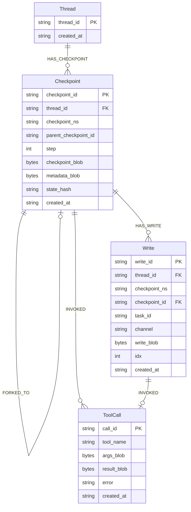
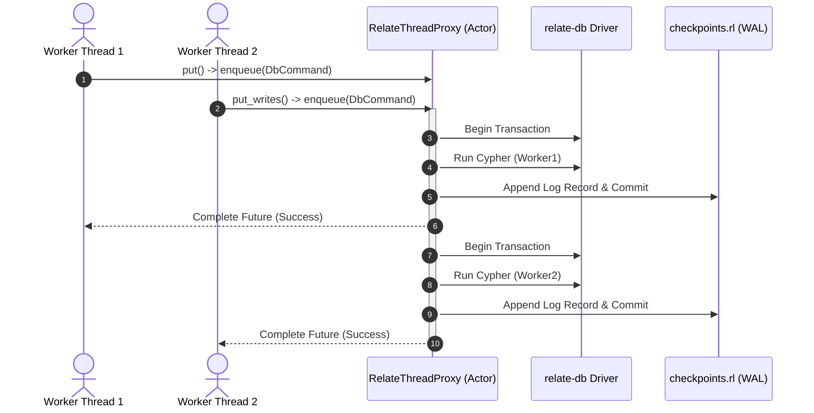

# System Architecture: RelateGraphSaver

Embedded graph-native checkpointing, thread-affinity serialization, and time-travel persistence architecture for LangGraph workflows.

Reference documents:
- [specification](SPEC.md)
- [decisions](DECISIONS.md)
- [overview](README.md)

Date: 2026-11-12  
Status: FROZEN

---

## Overview

RelateGraphSaver provides an embedded, graph-native checkpoint saver for LangGraph powered by the embedded Relate database engine from Neo4j. It eliminates the need for external database servers (e.g., PostgreSQL or Neo4j server daemons) by persisting agent execution state into a single local file (`.rl`) backed by Write-Ahead Logging (WAL). Workflows, branching paths, tool executions, and pending writes are mapped directly to a directed property graph. A dedicated actor queue (`RelateThreadProxy`) handles thread affinity and guarantees serialized write access across concurrent worker threads, while `TimeTravelEngine` enables zero-cleanup in-memory branching replays, and `DAGVisualizer` provides terminal-native Cypher diagnostics. Architectural rationale and alternatives are documented in [decisions](DECISIONS.md).

---

## Technology stack

- **Language:** Python 3.13
- **Graph Database Engine:** `relate-db` (Embedded Neo4j-compatible Cypher engine with single-file WAL storage and in-memory `:memory:` URI support)
- **Agent Framework:** `langgraph-checkpoint >= 2.0.0`, `langgraph >= 0.2.0`
- **Serialization:** `langgraph.checkpoint.serde.jsonplus.JsonPlusSerializer`
- **CLI & Terminal UI:** `typer >= 0.12.0`, `rich >= 13.7.0`
- **Type Checking & Linting:** `mypy >= 1.11.0`, `ruff >= 0.6.0`
- **Testing Runner:** `pytest >= 8.3.0`, `pytest-mock >= 3.14.0`

---

## Test commands

### Full test command
Runs every automated test across unit, integration, and CLI suites:
```bash
python -m pytest -q
```

### Fast test command
Runs formatting checks, linter, static type checker, and all fast tests (excluding tests tagged with `@pytest.mark.slow`):
```bash
ruff check . && ruff format --check . && mypy src tests && python -m pytest -q -m "not slow"
```

### One file test command
Runs a targeted test file:
```bash
python -m pytest -q tests/unit/test_<module>.py
```

*Note on test performance:* Tests that run full multi-agent simulation loops, process termination crash simulations, or large graph benchmarks are marked `@pytest.mark.slow`. The fast suite completes in under 15 seconds.

---

## Components

The system is structured into four deep modules with clear seams, high internal cohesion, and minimal surface area.



### Component Summary
- **`RelateSaver`:** Public adapter implementing LangGraph's `BaseCheckpointSaver` interface, handling serialization envelopes (`JsonPlusSerializer`), state versioning, and high-level checkpointer semantics.
- **`RelateThreadProxy`:** Actor queue and thread-affinity broker running on a dedicated thread, serializing database write transactions and enforcing single-writer access to prevent thread-affinity exceptions and file lock collisions.
- **`TimeTravelEngine`:** In-memory replay controller that extracts execution subgraphs and clones them into isolated `:memory:` database instances for zero-side-effect what-if debugging.
- **`DAGVisualizer`:** Graph forensics and diagnostic renderer that executes Cypher path queries to produce Unicode execution trees, cycle detection reports, and failure root-cause traces.

---

## Graph schema and data models

### Graph Schema Overview

The execution history of LangGraph workflows is mapped directly to a directed property graph:



### Node Labels and Properties

#### 1. `:Thread`
Represents an isolated LangGraph execution thread.
- `thread_id` (String, Indexed, Unique): Unique identifier of the workflow execution thread.
- `created_at` (String, ISO-8601): Timestamp when the thread was first registered.

#### 2. `:Checkpoint`
Represents an immutable snapshot of state at a discrete workflow step.
- `checkpoint_id` (String, Indexed, Unique): Unique checkpoint identifier (UUID or ULID generated by LangGraph).
- `thread_id` (String, Indexed): Parent thread identifier.
- `checkpoint_ns` (String, default `""`): Subgraph namespace identifier for nested multi-agent workflows.
- `parent_checkpoint_id` (String, Nullable): ID of the preceding checkpoint.
- `step` (Integer): Monotonically increasing execution step counter.
- `checkpoint_blob` (Bytes): Serialized channel state and versions encoded via `JsonPlusSerializer`.
- `metadata_blob` (Bytes): Serialized step metadata (writes, node name, source step).
- `state_hash` (String, Indexed): SHA-256 hash of serialized state channels used for O(1) cycle and oscillation detection.
- `created_at` (String, ISO-8601): Commit timestamp.

#### 3. `:Write`
Represents pending channel updates or intermediate writes (such as human-in-the-loop pending actions).
- `write_id` (String, Indexed, Unique): Composite identifier (`{thread_id}:{checkpoint_ns}:{checkpoint_id}:{task_id}:{idx}`).
- `thread_id` (String): Associated thread identifier.
- `checkpoint_ns` (String): Associated namespace.
- `checkpoint_id` (String): Targeted checkpoint identifier.
- `task_id` (String): LangGraph task identifier that emitted the write.
- `channel` (String): State channel receiving the write.
- `write_blob` (Bytes): Serialized write value.
- `idx` (Integer): Zero-based sequence index within the task emission batch.
- `created_at` (String, ISO-8601): Write timestamp.

#### 4. `:ToolCall`
Represents external tool invocations captured during graph step execution.
- `call_id` (String, Indexed, Unique): Tool call invocation identifier.
- `tool_name` (String): Executed tool function name.
- `args_blob` (Bytes): Serialized arguments passed to the tool.
- `result_blob` (Bytes, Nullable): Serialized return value.
- `error` (String, Nullable): Error message or stack trace if the invocation failed.
- `created_at` (String, ISO-8601): Invocation timestamp.

### Relationship Types

- `(:Thread)-[:HAS_CHECKPOINT]->(:Checkpoint)`: Connects a thread to all checkpoints within its lineage.
- `(:Checkpoint)-[:NEXT]->(:Checkpoint)`: Direct causal edge linking step $N$ to step $N+1$ along the primary execution branch.
- `(:Checkpoint)-[:FORKED_TO]->(:Checkpoint)`: Branch edge linking a historical checkpoint to the root checkpoint of a branched or replayed thread.
- `(:Checkpoint)-[:HAS_WRITE]->(:Write)`: Links a checkpoint to its pending or committed writes.
- `(:Checkpoint)-[:INVOKED]->(:ToolCall)`: Associates a checkpoint with external tools executed during that node step.
- `(:Write)-[:INVOKED]->(:ToolCall)`: Direct reference between an interrupted tool write action and the tool record.

### Cypher DDL Constraints and Indexes

Initialized automatically on database creation:
```cypher
CREATE CONSTRAINT thread_id_unique IF NOT EXISTS
FOR (t:Thread) REQUIRE t.thread_id IS UNIQUE;

CREATE CONSTRAINT checkpoint_id_unique IF NOT EXISTS
FOR (c:Checkpoint) REQUIRE c.checkpoint_id IS UNIQUE;

CREATE CONSTRAINT write_id_unique IF NOT EXISTS
FOR (w:Write) REQUIRE w.write_id IS UNIQUE;

CREATE CONSTRAINT tool_call_id_unique IF NOT EXISTS
FOR (tc:ToolCall) REQUIRE tc.call_id IS UNIQUE;

CREATE INDEX checkpoint_thread_idx IF NOT EXISTS
FOR (c:Checkpoint) ON (c.thread_id, c.checkpoint_ns, c.step);

CREATE INDEX checkpoint_hash_idx IF NOT EXISTS
FOR (c:Checkpoint) ON (c.state_hash);
```

---

## Interfaces and contracts

### 1. `RelateSaver` Interface

`RelateSaver` inherits from `langgraph.checkpoint.base.BaseCheckpointSaver` and implements standard synchronous checkpoint operations:

```python
from typing import Any, Iterator, Sequence
from langgraph.checkpoint.base import (
    BaseCheckpointSaver,
    Checkpoint,
    CheckpointMetadata,
    CheckpointTuple,
    ChannelVersions,
)
from langchain_core.runnables import RunnableConfig

class RelateSaver(BaseCheckpointSaver):
    def __init__(
        self,
        db_path: str = "checkpoints.rl",
        *,
        autocommit: bool = True,
        wal_enabled: bool = True,
    ) -> None: ...

    def put(
        self,
        config: RunnableConfig,
        checkpoint: Checkpoint,
        metadata: CheckpointMetadata,
        new_versions: ChannelVersions,
    ) -> RunnableConfig:
        """Persist a new checkpoint node and connect causal NEXT edge."""
        ...

    def put_writes(
        self,
        config: RunnableConfig,
        writes: Sequence[tuple[str, Any]],
        task_id: str,
    ) -> None:
        """Store pending channel writes and link them via HAS_WRITE."""
        ...

    def get_tuple(self, config: RunnableConfig) -> CheckpointTuple | None:
        """Retrieve the latest or targeted checkpoint tuple with pending writes."""
        ...

    def list(
        self,
        config: RunnableConfig | None,
        *,
        filter: dict[str, Any] | None = None,
        before: RunnableConfig | None = None,
        limit: int | None = None,
    ) -> Iterator[CheckpointTuple]:
        """Yield checkpoint tuples ordered reverse-chronologically by step."""
        ...

    def fork_in_memory(
        self,
        thread_id: str,
        checkpoint_id: str,
    ) -> "RelateSaver":
        """Clone history up to checkpoint_id into an isolated :memory: database."""
        ...

    def detect_loops(
        self,
        thread_id: str,
        threshold: int = 2,
    ) -> list["LoopReport"]:
        """Identify state oscillation or repeating cycle paths in the Cypher DAG."""
        ...

    def trace_root_cause(
        self,
        thread_id: str,
    ) -> "RootCauseReport":
        """Trace causal antecedent edges from an error node to the offending write."""
        ...

    def close(self) -> None:
        """Flush pending queues and gracefully terminate the proxy worker thread."""
        ...
```

### 2. `RelateThreadProxy` Actor Protocol

Embedded databases require strict thread affinity for file writing. The `RelateThreadProxy` encapsulates all direct database driver calls inside an isolated worker actor thread:

```python
import concurrent.futures
from dataclasses import dataclass
from typing import Any

@dataclass(frozen=True)
class DbCommand:
    cypher: str
    params: dict[str, Any]
    is_write: bool
    future: concurrent.futures.Future[Any]

class RelateThreadProxy:
    def __init__(self, db_path: str, wal_enabled: bool = True) -> None: ...
    def execute_write(self, cypher: str, params: dict[str, Any]) -> Any: ...
    def execute_read(self, cypher: str, params: dict[str, Any]) -> Any: ...
    def execute_batch(self, statements: list[tuple[str, dict[str, Any]]]) -> list[Any]: ...
    def stop(self) -> None: ...
```

### 3. Forensic Data Models

```python
from dataclasses import dataclass

@dataclass(frozen=True)
class LoopReport:
    thread_id: str
    cycle_nodes: list[str]
    occurrence_count: int
    checkpoint_id_range: tuple[str, str]

@dataclass(frozen=True)
class RootCauseReport:
    thread_id: str
    error_checkpoint_id: str
    error_message: str
    root_tool_call_id: str | None
    root_channel_write: str | None
    causal_path_length: int
    diagnostic_summary: str
```

### 4. CLI Command Interface (`relate-dag`)

The CLI provides an interactive terminal interface for workflow exploration:

- **`relate-dag tree <thread_id> [--file <path>]`**
  Renders a Unicode DAG tree of checkpoints, branching points, and status tags (`[PENDING]`, `[ERROR]`, `[OK]`).
- **`relate-dag replay <thread_id> --checkpoint <id> [--edit <json>]`**
  Spawns an interactive in-memory replay session starting from the specified checkpoint.
- **`relate-dag forensics loops <thread_id> [--threshold <int>]`**
  Queries the Cypher graph for repeating state transitions and displays cycle tables.
- **`relate-dag forensics trace-error <thread_id>`**
  Traverses backward causal paths to print root-cause analysis for failed threads.

### 5. In-Memory Fakes for Testing

To ensure ultra-fast unit testing without disk I/O, the suite includes an in-memory seam fake:

```python
class InMemoryRelateDriver:
    """In-memory dictionary/graph fake mimicking relate-db Cypher engine."""
    def __init__(self) -> None:
        self.nodes: dict[str, dict[str, Any]] = {}
        self.edges: list[tuple[str, str, str]] = []

    def run(self, query: str, parameters: dict[str, Any] | None = None) -> list[dict[str, Any]]:
        ...
```

---

## Concurrency and crash safety model

### Thread Affinity and Actor Queue



1. **Serialized Writes:** All mutating operations (`put`, `put_writes`, `fork`) pass through the `RelateThreadProxy` command queue. The proxy executes strictly on a single dedicated background thread, eliminating DB-API thread-affinity violations and file-lock collisions.
2. **Crash Resilience:** Every commit flushes through the Write-Ahead Log before acknowledging caller futures. If the host process crashes mid-step, uncommitted transactions are rolled back during WAL recovery on restart, guaranteeing zero orphaned nodes or dangling edges.
3. **Deadlock Prevention:** Calling threads wait synchronously on lightweight `concurrent.futures.Future` objects with configurable timeout guards. Reads and writes cannot interleave within an active atomic transaction.

---

## Directory layout

```
RelateGraphSaver/
├── .env.example
├── pyproject.toml
├── README.md
├── docs/
│   ├── ARCHITECTURE.md
│   ├── DECISIONS.md
│   ├── README.md
│   └── SPEC.md
├── src/
│   └── langgraph_checkpoint_relate/
│       ├── __init__.py
│       ├── cli.py              # CLI entry point (relate-dag)
│       ├── errors.py           # Custom exception taxonomy
│       ├── forensics.py        # Cypher loop & root-cause queries
│       ├── models.py           # DTOs and report data structures
│       ├── proxy.py            # RelateThreadProxy actor implementation
│       ├── saver.py            # RelateSaver (BaseCheckpointSaver)
│       ├── schema.py           # Cypher constraints and schema migrations
│       ├── serde.py            # JsonPlusSerializer wrapper & error mapper
│       ├── time_travel.py      # TimeTravelEngine in-memory sandbox
│       └── visualizer.py       # Rich/Unicode tree terminal renderer
├── tests/
│   ├── conftest.py             # Shared fixtures and in-memory fakes
│   ├── unit/
│   │   ├── test_errors.py
│   │   ├── test_models.py
│   │   ├── test_proxy.py
│   │   ├── test_saver.py
│   │   ├── test_serde.py
│   │   └── test_visualizer.py
│   ├── integration/
│   │   ├── test_cli.py
│   │   ├── test_concurrency.py
│   │   ├── test_crash_recovery.py
│   │   ├── test_forensics.py
│   │   ├── test_langgraph_workflow.py
│   │   └── test_time_travel.py
│   └── fakes/
│       ├── __init__.py
│       └── fake_relate_driver.py
└── examples/
    └── research_agent.py       # Multi-agent demo workflow
```

---

## Configuration

Configuration parameters can be supplied directly to `RelateSaver` or read from environment variables:

| Environment Variable | Type | Default | Description |
| :--- | :--- | :--- | :--- |
| `RELATE_DB_PATH` | string | `"checkpoints.rl"` | Default file path for durable embedded graph storage |
| `RELATE_WAL_ENABLED` | boolean | `true` | Enables Write-Ahead Logging for atomic crash safety |
| `RELATE_PROXY_TIMEOUT_SEC` | float | `30.0` | Maximum wait time for actor queue transactions before raising timeout |
| `RELATE_LOG_LEVEL` | string | `"INFO"` | Logging verbosity (`DEBUG`, `INFO`, `WARNING`, `ERROR`) |

---

## Setup requirements

### Tools
| Tool | Minimum Version | Verification Command | Notes |
| :--- | :--- | :--- | :--- |
| Python | 3.13 | `python --version` | Required runtime environment |
| pip | 24.0+ | `python -m pip --version` | Standard Python package installer |
| git | 2.40+ | `git --version` | Version control |

### Accounts and credentials
None. The RelateGraphSaver engine operates completely in-process as an embedded system. It requires no external cloud accounts, SaaS API tokens, or paid credentials.

### Local services
None. All graph storage is managed in-process via single-file `.rl` databases or `:memory:` targets. No Docker containers, PostgreSQL servers, or background daemon services are required.

---

## Expensive to change

The following architectural choices are costly to alter post-implementation:

1. **Graph Schema and Relationship Taxonomy:**
   - *Components:* `(:Thread)`, `(:Checkpoint)`, `(:Write)`, `(:ToolCall)` and edges `[:NEXT]`, `[:FORKED_TO]`, `[:HAS_WRITE]`, `[:INVOKED]`.
   - *Why expensive:* Changing node labels or relationship semantics breaks all historical Cypher queries used by `DAGVisualizer`, loop detection, and root-cause analysis, and requires physical database schema migrations.
2. **Binary State Serialization Protocol:**
   - *Components:* `JsonPlusSerializer` envelope stored in `checkpoint_blob` and `write_blob`.
   - *Why expensive:* Checkpoint blobs are written immutably to disk. Modifying the serialization format invalidates previously written checkpoints and risks breaking deserialization of complex types (e.g., Pydantic models, LangChain messages).
3. **Actor Concurrency Model (`RelateThreadProxy`):**
   - *Components:* Single-writer actor queue dispatch.
   - *Why expensive:* Multi-threaded LangGraph executions rely on this boundary to avoid engine crashes and file lock collisions. Replacing it with connection pooling or multi-process sharing would require fundamental rewrites of transaction lifecycle management.
4. **LangGraph BaseCheckpointSaver Seam:**
   - *Components:* Method signatures and return structures (`put`, `put_writes`, `get_tuple`, `list`).
   - *Why expensive:* Direct contract adherence to LangGraph's runtime is necessary for plug-and-play compatibility across all LangGraph graphs, subgraphs, and human-in-the-loop constructs.
