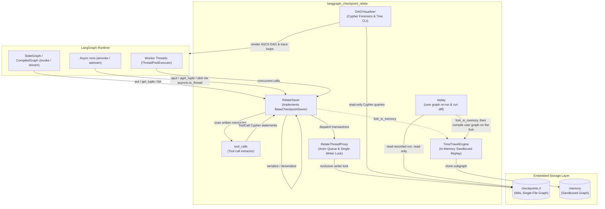
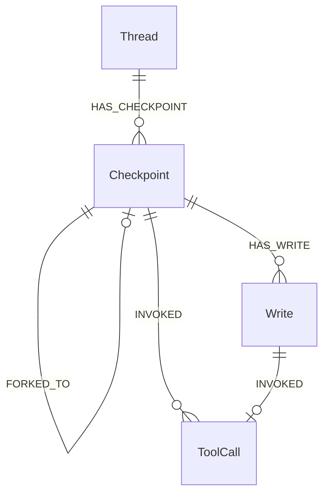

# System Architecture: RelateGraphSaver

Embedded graph-native checkpointing, thread-affinity serialization, and time-travel persistence architecture for LangGraph workflows.

Reference documents: [specification](SPEC.md), [decisions](DECISIONS.md), [overview](README.md).

Date: 2026-11-18  
Status: FROZEN

## Overview

RelateGraphSaver provides an embedded, graph-native checkpoint saver for LangGraph powered by the embedded Relate database engine from Neo4j. It needs no external database server (PostgreSQL or a Neo4j server daemon): execution state is persisted into a single local `.rl` file backed by Write-Ahead Logging (WAL). Workflows, branching paths, tool executions, and pending writes map directly to a directed property graph. A dedicated actor queue (`RelateThreadProxy`) handles thread affinity and serializes write access across concurrent worker threads, `TimeTravelEngine` enables zero-cleanup in-memory branching replays, and `DAGVisualizer` provides terminal-native Cypher diagnostics. Tool calls made by the model during a real run are captured from the persisted LangChain messages into `:ToolCall` nodes, so root-cause analysis works on data the run itself produced ([ADR-0005](DECISIONS.md#adr-0005-capture-tool-calls-from-persisted-langchain-messages)). Async graph execution (`ainvoke`, `astream`) runs the synchronous methods off the event loop ([ADR-0006](DECISIONS.md#adr-0006-async-checkpointer-methods-delegate-to-the-synchronous-methods-on-worker-threads)). Inspection commands open the store read-only ([ADR-0015](DECISIONS.md#adr-0015-read-only-opening-for-inspection-commands)). `replay.py` re-runs a user's graph from a stored checkpoint inside an in-memory fork and diffs the result against the recorded run ([ADR-0017](DECISIONS.md#adr-0017-replay-runs-user-graph-code-only-against-an-in-memory-sandbox)); forensics traces a failing tool's argument back to the write that first held it and summarizes tool failures across threads ([ADR-0018](DECISIONS.md#adr-0018-argument-provenance-by-string-containment-earliest-write-wins)). The committed demo store includes a run against the public PyPI JSON API ([ADR-0019](DECISIONS.md#adr-0019-the-demo-store-holds-a-real-api-thread-and-its-build-needs-network-access)). Rationale and alternatives are in [decisions](DECISIONS.md).

## Technology stack

- **Language:** Python 3.11+ (`requires-python = ">=3.11"`; developed and tested on 3.13)
- **Graph Database Engine:** `relate-db` (Embedded Neo4j-compatible Cypher engine with single-file WAL storage and in-memory `:memory:` URI support). The requirement is `>=1.1.0`: the full suite and the benchmark pass on 1.1.0 ([ADR-0020](DECISIONS.md#adr-0020-relate-db-version-policy-decided-by-the-test-result))
- **Agent Framework:** `langgraph-checkpoint >= 2.0.0`, `langgraph >= 0.2.0`, `langchain-core >= 0.2.0` (imported directly for `RunnableConfig` and message types; declared explicitly per [ADR-0009](DECISIONS.md#adr-0009-declare-every-directly-imported-runtime-dependency-and-prove-it-with-a-clean-install))
- **Serialization:** `langgraph.checkpoint.serde.jsonplus.JsonPlusSerializer`
- **Async:** standard library `asyncio` (`asyncio.to_thread`); no async database driver
- **CLI & Terminal UI:** `typer >= 0.12.0`, `click >= 8.1.0`, `rich >= 13.7.0`
- **Type Checking & Linting:** `mypy >= 1.11.0`, `ruff >= 0.6.0`
- **Testing Runner:** `pytest >= 8.3.0`, `pytest-mock >= 3.14.0`. Async tests call `asyncio.run(...)` inside ordinary test functions; no pytest async plugin is added.
- **Benchmark (dev only):** `langgraph-checkpoint-sqlite >= 2.0.0` in the `dev` extra, never in `[project].dependencies` ([ADR-0008](DECISIONS.md#adr-0008-standalone-benchmark-script-against-sqlitesaver)). Optional `llm` extra: `langchain-openai`, used only by `examples/openrouter_agent.py`. The demo HTTP client is the standard library (`urllib.request`).

## Test commands

All commands run from the repository root with the project virtual environment active (`source .venv/Scripts/activate` in Git Bash, `.venv\Scripts\Activate.ps1` in PowerShell). A globally installed `ruff` or `mypy` may be a different version and give different results.

### Full test command
Runs every automated test across unit, integration, and CLI suites, including `slow` tests:
```bash
python -m pytest -q
```
The slow clean-install test (AC-33) creates a fresh virtual environment and installs the package from the package index, so it needs network access. Without it, the test is skipped with a stated reason, and only when pip's own output shows that the package index could not be reached; every other install failure fails the test ([ADR-0013](DECISIONS.md#adr-0013-clean-install-test-skips-only-when-the-package-index-is-unreachable), see [Clean-install test](#clean-install-test-testsintegrationtest_clean_installpy)).

### Fast test command
Runs formatting checks, linter, static type checker, and all fast tests (excluding tests tagged with `@pytest.mark.slow`):
```bash
ruff check . && ruff format --check . && mypy src tests && python -m pytest -q -m "not slow"
```
All four steps exit 0 (AC-35, AC-36, AC-37, AC-38). `ruff` covers every Python file in the repository, including `benchmarks/` and `examples/`; `mypy` covers `src` and `tests` only. The mypy configuration that makes this possible is described in [ADR-0007](DECISIONS.md#adr-0007-static-quality-gates-pass-through-configuration-and-behavior-neutral-fixes).

**`network` marker (AC-131, RC-11).** The one live test that calls pypi.org is marked `@pytest.mark.network`, registered in `pyproject.toml` next to `slow`. `tests/conftest.py` deselects `network` items in `pytest_collection_modifyitems` (reporting them through `pytest_deselected`) unless the `-m` expression contains `network`, so the full and fast commands above stay offline and unchanged, and `python -m pytest -m network` runs the live test by hand. We do not add `-m "not network"` to `addopts`: a second `-m` on the command line replaces it, so `-m "not slow"` would select the live test again.

### One file test command
```bash
python -m pytest -q tests/unit/test_<module>.py
```

### Benchmark command (not a test)
```bash
python benchmarks/bench_checkpointers.py --checkpoints 1000
```
The benchmark is not collected by pytest (`testpaths = ["tests"]`, and the file is not named `test_*`). See [Benchmark](#benchmark).

*Note on test performance:* Tests that run full multi-agent simulation loops, process termination crash simulations, fresh-environment installs, or large graph workloads are marked `@pytest.mark.slow`. The fast suite targets under 15 seconds but measured about 100 seconds on the development machine on 2026-11-18; new replay and demo tests reuse session-scoped stores to avoid adding to it.

## Components



### Component Summary
- **`RelateSaver`:** Public adapter implementing LangGraph's `BaseCheckpointSaver` interface, handling serialization envelopes (`JsonPlusSerializer`), state versioning, high-level checkpointer semantics, and the async methods that delegate to the synchronous ones.
- **`tool_calls` (tool call extractor):** Pure functions that find AI tool calls and tool result messages in written values and turn them into idempotent `:ToolCall` Cypher statements, plus `AppliedToolCalls`, the per-saver record of what has already been committed so each save sends only new statements. It never raises; malformed entries are skipped.
- **`RelateThreadProxy`:** Actor queue and thread-affinity broker running on a dedicated thread, serializing database write transactions and enforcing single-writer access to prevent thread-affinity exceptions and file lock collisions.
- **`TimeTravelEngine`:** In-memory replay controller that extracts execution subgraphs and clones them into isolated `:memory:` database instances for zero-side-effect what-if debugging.
- **`DAGVisualizer`:** Graph forensics and diagnostic renderer that executes Cypher path queries to produce Unicode execution trees, cycle detection reports, and failure root-cause traces. Status tags follow the [tree status rule](#tree-status-rule).
- **`RelateForensics`** (`forensics.py`): loop detection, root-cause tracing, [argument provenance and the cross-thread failure summary](#9-argument-provenance-and-tool-failure-summary-forensicspy).
- **`replay`** (`replay.py`): loads a user's graph from a spec, re-runs it from a checkpoint against an in-memory fork, and diffs it against the recorded run ([Replay engine](#8-replay-engine-replaypy)).

## Graph schema and data models

### Graph Schema Overview

The execution history of LangGraph workflows is mapped directly to a directed property graph:


Properties of each label are listed under [Node Labels and Properties](#node-labels-and-properties).

### Node Labels and Properties

#### 1. `:Thread`
An isolated LangGraph execution thread: `thread_id` (String, Indexed, Unique) and `created_at` (String, ISO-8601, when the thread was first registered).

#### 2. `:Checkpoint`
An immutable snapshot of state at one workflow step.
- `checkpoint_id` (String, Indexed, Unique; UUID generated by LangGraph), `thread_id` (String, Indexed), `checkpoint_ns` (String, default `""`, subgraph namespace), `parent_checkpoint_id` (String, Nullable).
- `step` (Integer, monotonically increasing), `created_at` (String, ISO-8601 commit timestamp).
- `checkpoint_blob` (Bytes): channel values, channel versions and `versions_seen`, encoded via `JsonPlusSerializer`. `metadata_blob` (Bytes): serialized step metadata (source, step).
- `state_hash` (String, Indexed): SHA-256 of the serialized state channels, used for O(1) cycle and oscillation detection.

#### 3. `:Write`
A pending channel update or intermediate write (such as a human-in-the-loop pending action), stored on the checkpoint its task ran from.
- `write_id` (String, Indexed, Unique): `{thread_id}:{checkpoint_ns}:{checkpoint_id}:{task_id}:{idx}`.
- `thread_id`, `checkpoint_ns`, `checkpoint_id` (String): where the write belongs. `task_id` (String): LangGraph task that emitted it. `channel` (String): state channel receiving it.
- `write_blob` (Bytes, serialized value), `idx` (Integer, zero-based index within the task's batch), `created_at` (String, ISO-8601).

#### 4. `:ToolCall`
Represents one tool invocation requested by the model, written by `RelateSaver` from the LangChain messages of a real run ([ADR-0005](DECISIONS.md#adr-0005-capture-tool-calls-from-persisted-langchain-messages)). These are exactly the properties `forensics.py` reads; no other properties are written.

| Property | Type | Set when | Source |
| :--- | :--- | :--- | :--- |
| `call_id` | String, Unique | Node creation | `AIMessage.tool_calls[i]["id"]`, verbatim (no prefix) |
| `tool_name` | String | Node creation | `AIMessage.tool_calls[i]["name"]` |
| `args_blob` | Bytes | Node creation | `serde.dumps(tool_calls[i]["args"])`, the same `JsonPlusSerializer` envelope as `write_blob` |
| `result_blob` | Bytes, Nullable | First outcome, if not an error | `serde.dumps(ToolMessage.content)` |
| `error` | String, Nullable | First outcome, if `ToolMessage.status == "error"` | Error text (see [Tool call capture](#6-tool-call-capture-tool_callspy)) |
| `created_at` | String, ISO-8601 | Node creation | Timestamp of the save that first saw the call |

Validation and invariants:
- A tool call without a non-empty string `id` or `name` is skipped (AC-47).
- At most one of `result_blob` and `error` is ever set. The first outcome recorded wins; later outcome writes for the same `call_id` change nothing.
- Properties not yet known are absent (read back as null), never empty strings. Forensics treats `error IS NOT NULL AND error <> ''` as a failure.
- `call_id` is globally unique (`tool_call_id_unique` constraint). If two threads reuse the same id (typical only of hand-written fakes), they share one node; each thread still gets its own `[:INVOKED]` edge, and the first outcome wins. Real model providers generate unique ids; the demo and tests generate `call_<uuid4 hex>` ids.
- `ToolCallNode` in `models.py` has this shape.

### Relationship Types

- `(:Thread)-[:HAS_CHECKPOINT]->(:Checkpoint)`: Connects a thread to all checkpoints within its lineage.
- `(:Checkpoint)-[:NEXT]->(:Checkpoint)`: Direct causal edge linking step $N$ to step $N+1$ along the primary execution branch.
- `(:Checkpoint)-[:FORKED_TO]->(:Checkpoint)`: Branch edge linking a historical checkpoint to the root checkpoint of a branched or replayed thread.
- `(:Checkpoint)-[:HAS_WRITE]->(:Write)`: Links a checkpoint to its pending or committed writes.
- `(:Checkpoint)-[:INVOKED]->(:ToolCall)`: Links the checkpoint at which a thread first recorded a tool call to that call. For `put_writes()` this is the checkpoint named by `config["configurable"]["checkpoint_id"]` (the checkpoint the model's task ran from, AC-41); for `put()` it is the checkpoint being stored (AC-42). Exactly one such edge exists per (thread, `call_id`): a later save in the same thread that sees the same call adds no edge. LangGraph saves the model step's writes and the next checkpoint on different threads, so the edge attaches to the step the model ran from or to the next one, whichever save lands first ([ADR-0021](DECISIONS.md#adr-0021-tool-call-root-cause-anchors-on-the-failure-checkpoint)).
- `(:Write)-[:INVOKED]->(:ToolCall)`: Reserved. The saver does not write this edge; forensics, including `failure_summary` (AC-158), reads it if present, so data that contains it keeps working.

### Cypher DDL Constraints and Indexes

Initialized automatically on database creation:
```cypher
CREATE CONSTRAINT thread_id_unique IF NOT EXISTS
FOR (t:Thread) REQUIRE t.thread_id IS UNIQUE;
CREATE CONSTRAINT checkpoint_id_unique IF NOT EXISTS
FOR (c:Checkpoint) REQUIRE c.checkpoint_id IS UNIQUE;
CREATE CONSTRAINT write_id_unique IF NOT EXISTS
FOR (w:Write) REQUIRE w.write_id IS UNIQUE;
CREATE CONSTRAINT tool_call_id_unique IF NOT EXISTS
FOR (tc:ToolCall) REQUIRE tc.call_id IS UNIQUE;
CREATE INDEX checkpoint_thread_idx IF NOT EXISTS
FOR (c:Checkpoint) ON (c.thread_id, c.checkpoint_ns, c.step);
CREATE INDEX checkpoint_hash_idx IF NOT EXISTS
FOR (c:Checkpoint) ON (c.state_hash);
```

## Interfaces and contracts

### 1. `RelateSaver` Interface

`RelateSaver` inherits from `langgraph.checkpoint.base.BaseCheckpointSaver` and implements the synchronous checkpoint operations plus their async counterparts. `put()` and `put_writes()` capture tool calls after the checkpoint or writes are committed.

```python
from collections.abc import AsyncIterator, Iterator, Sequence
from typing import Any
from langgraph.checkpoint.base import (BaseCheckpointSaver, Checkpoint, CheckpointMetadata,
                                       CheckpointTuple, ChannelVersions)
from langchain_core.runnables import RunnableConfig

class RelateSaver(BaseCheckpointSaver[str]):
    def __init__(
        self,
        db_path: str | RelateThreadProxy = ":memory:",
        *,
        wal_enabled: bool = True,
        proxy: RelateThreadProxy | None = None,
        serde: RelateStateSerializer | SerializerProtocol | None = None,
        connection_factory: Any | None = None,
        read_only: bool = False,   # see Read-only mode (ADR-0015)
    ) -> None: ...

    # --- synchronous ---
    def put(self, config: RunnableConfig, checkpoint: Checkpoint,
            metadata: CheckpointMetadata, new_versions: ChannelVersions) -> RunnableConfig:
        """Persist a checkpoint node, connect NEXT/FORKED_TO, then capture tool calls
        found in checkpoint["channel_values"] (AC-42)."""
    def put_writes(self, config: RunnableConfig, writes: Sequence[tuple[str, Any]],
                   task_id: str, task_path: str = "") -> None:
        """Store pending writes linked via HAS_WRITE, then capture tool calls found in
        the written values (AC-41)."""
    def get_tuple(self, config: RunnableConfig) -> CheckpointTuple | None: ...
    def list(self, config: RunnableConfig | None, *, filter: dict[str, Any] | None = None,
             before: RunnableConfig | None = None, limit: int | None = None
             ) -> Iterator[CheckpointTuple]: ...
    def fork_in_memory(self, thread_id: str, checkpoint_id: str, *,
                       branch_thread_id: str | None = None) -> "RelateSaver": ...
    def detect_loops(self, thread_id: str, threshold: int = 2) -> list["LoopReport"]: ...
    def trace_root_cause(self, thread_id: str) -> "RootCauseReport": ...
    def close(self) -> None: ...

    # --- async ---
    async def aget_tuple(self, config: RunnableConfig) -> CheckpointTuple | None: ...
    async def alist(self, config: RunnableConfig | None, *, filter: dict[str, Any] | None = None,
                    before: RunnableConfig | None = None, limit: int | None = None
                    ) -> AsyncIterator[CheckpointTuple]: ...
    async def aput(self, config: RunnableConfig, checkpoint: Checkpoint,
                   metadata: CheckpointMetadata, new_versions: ChannelVersions) -> RunnableConfig: ...
    async def aput_writes(self, config: RunnableConfig, writes: Sequence[tuple[str, Any]],
                          task_id: str, task_path: str = "") -> None: ...
```

#### Async method contract
- Each async method is `await asyncio.to_thread(<sync method>, <same arguments>)`. `alist` runs `list(self.list(config, filter=filter, before=before, limit=limit))` in one `to_thread` call, then yields the materialized tuples in order.
- Results equal the synchronous counterpart for the same inputs (AC-50); errors are the same exception types, raised from the `await`.
- The synchronous method never runs on the event loop thread (AC-54). Writes still go through `RelateThreadProxy`, so ordering and single-writer guarantees are identical to synchronous use.
- Cancelling the awaiting task does not abort a write already handed to a worker thread; the write completes and is committed.
- `delete_thread` / `adelete_thread`: `RelateSaver` defines neither, so the base-class behavior stays (AC-55). If a synchronous `delete_thread` is added later, `adelete_thread` must be added in the same change as `asyncio.to_thread(self.delete_thread, thread_id)`.
- Rationale and rejected options: [ADR-0006](DECISIONS.md#adr-0006-async-checkpointer-methods-delegate-to-the-synchronous-methods-on-worker-threads).

#### Tool call capture inside `put()` and `put_writes()`
- `__init__` creates `self._applied_tool_calls = AppliedToolCalls()` on every construction path (own proxy, passed proxy, proxy as `db_path`). Two savers sharing one proxy each have their own record; that is safe because every statement is idempotent.
- `put_writes()`: after its `execute_batch` succeeds, calls the private helper `_capture_tool_calls(values=[value for _, value in writes], thread_id=thread_id, checkpoint_id=checkpoint_id_str)`.
- `put()`: after its `execute_write` succeeds, calls `_capture_tool_calls(values=checkpoint["channel_values"].values(), thread_id=thread_id, checkpoint_id=checkpoint_id)` when `channel_values` is a dict; otherwise does nothing.
- `_capture_tool_calls` runs on the calling thread, in this order ([ADR-0011](DECISIONS.md#adr-0011-send-only-new-tool-call-statements-tracked-per-saver)):
  1. `events = extract_tool_events(values)`.
  2. `plan = self._applied_tool_calls.plan(events, thread_id=thread_id)`.
  3. If `plan.events` has no invocations and no outcomes: return. Nothing is serialized and nothing is submitted to the proxy.
  4. `statements = build_tool_call_statements(plan.events, thread_id=..., checkpoint_id=..., serde=..., created_at=...)`; if non-empty, `detached = detached_call_ids(self.proxy.execute_batch(statements, flush=False))` ([ADR-0014](DECISIONS.md#adr-0014-tool-call-capture-commits-without-its-own-flush)); otherwise `detached` is empty.
  5. `self._applied_tool_calls.mark_applied(plan, thread_id=thread_id, detached=detached)`, reached only when step 4's batch returned normally or had nothing to send (every entry failed serialization).
- It catches every `Exception`, logs at WARNING with the checkpoint id and the exception class name only (never argument or result content), and returns normally. On any exception nothing is marked, so the next save that sees the same calls sends them again. Tool call capture can never make `put()` or `put_writes()` raise or roll back (AC-47).
- No messages in the values means no statements, no `:ToolCall` nodes and no `[:INVOKED]` edges (AC-46).
- Observable result: a save whose values contain only calls and outcomes this saver has already committed makes exactly one proxy submission (the checkpoint or write transaction). Sending only new statements leaves the stored graph the same as resending everything, except for the cases under [Applied tool call record](#applied-tool-call-record).

#### Read-only mode

`RelateSaver(path, read_only=True)` opens a file store for inspection and leaves it byte-identical, with no sidecar files ([ADR-0015](DECISIONS.md#adr-0015-read-only-opening-for-inspection-commands)). The default is `read_only=False`.

- **Opening:** the saver builds its proxy with `RelateThreadProxy(path, read_only=True)`, which connects with `relate.connect(database=path, read_only=True)`, creates no directories, and runs no schema setup. `wal_enabled` is ignored.
- **Reads that work:** `get_tuple`, `list`, `aget_tuple`, `alist`, `detect_loops`, `trace_root_cause`, `fork_in_memory`, and `DAGVisualizer` / `RelateForensics` built on the saver.
- **Writes that fail:** `put`, `put_writes`, `aput`, `aput_writes` raise `RelateReadOnlyError` (subclass of `RelateCheckpointError`, exported from the package) before serializing anything or contacting the proxy. The async forms raise it from the `await`.
- **Flush and close:** `flush()` does nothing; `close()` closes the connection without flushing.
- **Construction errors:** `ValueError` for `read_only=True` with `":memory:"`, and for `read_only=True` with a passed proxy whose `read_only` is false. With a passed proxy, `saver.read_only` equals `proxy.read_only`. A missing file raises `RelateConnectionError` and is not created.
- **Connection factory:** a custom `connection_factory` is still called as `factory(db_path)`; it must open its driver read-only itself. Writes are refused by the saver and proxy either way, but the byte-identical guarantee covers only the default driver.
- **Schema:** no constraint or index is created or upgraded. Inspection queries are plain `MATCH` reads and work on stores that lack them (scanning instead of using an index). A store without `:ToolCall` nodes reports no tool calls.
- **Snapshot:** the store is loaded once at open; data saved afterwards by another process is visible only after reopening.

#### `fork_in_memory` contract

`fork_in_memory(thread_id, checkpoint_id, *, branch_thread_id=None)` delegates to `TimeTravelEngine.fork_in_memory` in `time_travel.py` ([ADR-0004](DECISIONS.md#adr-0004-in-memory-graph-cloning-for-zero-side-effect-time-travel-sandboxing), amended by [ADR-0010](DECISIONS.md#adr-0010-in-memory-forks-copy-tool-call-data)).

**Copied set.** The lineage is the target checkpoint plus every ancestor reached by following `parent_checkpoint_id`. Into a new `RelateSaver(":memory:")` the fork copies:
- the source `:Thread` node, every lineage `:Checkpoint` with its `[:HAS_CHECKPOINT]` edge, and the `[:NEXT]` / `[:FORKED_TO]` edges between lineage checkpoints;
- every `:Write` linked by `[:HAS_WRITE]` from a lineage checkpoint;
- every `:ToolCall` that has an `[:INVOKED]` edge from a lineage checkpoint, and each of those `(:Checkpoint)-[:INVOKED]->(:ToolCall)` edges whose checkpoint is in the lineage. Not copied: `:ToolCall` nodes reached only from checkpoints outside the lineage (later checkpoints, other branches, other threads), `[:INVOKED]` edges from checkpoints outside the lineage, and the reserved `(:Write)-[:INVOKED]->(:ToolCall)` edges.

**Tool call read.** One read on the source proxy, after the lineage ids are known:
```cypher
MATCH (c:Checkpoint)-[:INVOKED]->(tc:ToolCall) WHERE c.checkpoint_id IN $ids
RETURN c.checkpoint_id AS checkpoint_id, tc.call_id AS call_id, tc.tool_name AS tool_name, tc.args_blob AS args_blob,
       tc.result_blob AS result_blob, tc.error AS error, tc.created_at AS created_at
```
One row per edge. A `RelateCheckpointError` from this read propagates to the caller; the fork is not returned without its tool calls, because forensics on such a fork would silently differ from the source.

**Outcomes only up to the fork point.** Before building statements, the fork deserializes the fork-point checkpoint's `checkpoint_blob` (already read with the lineage) with `source_saver.serde.loads(_extract_bytes(...))` and, if its `channel_values` is a dict, runs `extract_tool_events(channel_values.values())` from `tool_calls.py`; no other parsing is done. The `call_id`s of the resulting outcomes form the *fork-point outcome set* (empty when `channel_values` is missing or not a dict). A copied node keeps the source's stored `result_blob` or `error` only if its `call_id` is in that set; otherwise it is copied without either property, so a replay in the fork records its own first outcome. Results that exist only in the fork point's pending writes, or only in later checkpoints, do not count. If the blob cannot be deserialized, the fork raises `RelateCheckpointError`.

**Tool call writes**, appended to the single population batch after the `:Write` statements and before the optional branch `[:FORKED_TO]` statement:
- One node statement per distinct `call_id`: `MERGE (tc:ToolCall {call_id: $call_id})` followed by `SET tc.<p> = $<p>` for each of `tool_name`, `args_blob`, `created_at` whose source value is not null, plus `result_blob` and `error` under the same condition only when the `call_id` is in the fork-point outcome set. Null properties are left absent, matching the [`:ToolCall` schema](#4-toolcall). The property names come from this fixed list, never from data. Blob values pass through `_extract_bytes`.
- One edge statement per row: `MATCH (c:Checkpoint {checkpoint_id: $checkpoint_id}), (tc:ToolCall {call_id: $call_id}) MERGE (c)-[:INVOKED]->(tc)`.

**Guarantees.**
- For a fork taken at a checkpoint whose channel values already contain the failing tool's result message (for example the thread's latest checkpoint), `trace_root_cause(thread_id)` on the fork returns the same `error_checkpoint_id`, `error_message`, `root_tool_call_id` and `root_tool_name` as on the source.
- For a fork taken before that result, the call is present with no `result_blob` and no `error`; resuming the graph in the fork with the tool succeeding records `result_blob` on that node, and `error` stays absent.
- The source is only read, through `execute_read`; every statement, including the optional branch `[:FORKED_TO]` edge, goes to the fork's own `:memory:` saver. A writable source saver still rewrites part of its file on open and close, so a caller who needs the source file unchanged opens it with `read_only=True` ([Read-only mode](#read-only-mode)); the fork works the same on either. The fork itself is always writable and never inherits `read_only`. The test opens the source read-only and compares the sha256 of the source `.rl` file before and after the fork and close.
- The population batch goes straight to the fork's proxy, not through `put()`, so the fork's `AppliedToolCalls` record starts empty. The first `put()` in a replay rescans and resends what it sees; `MERGE`, the per-thread edge condition and the first-outcome-wins guard make that a no-op for data already copied.

### 2. `RelateThreadProxy` Actor Protocol

Embedded databases require strict thread affinity for file writing. `RelateThreadProxy` runs every driver call on one dedicated worker thread, the only thread that touches the driver; callers on any thread (LangGraph worker threads, `asyncio.to_thread` workers) block on the command future.

```python
import concurrent.futures
from dataclasses import dataclass
from typing import Any

@dataclass(frozen=True)
class DbCommand:
    cypher: str
    params: dict[str, Any]
    is_write: bool
    future: concurrent.futures.Future[Any]

class RelateThreadProxy:
    def __init__(self, db_path: str = ":memory:", wal_enabled: bool = True,
                 connection_factory: Callable[..., Any] | None = None,
                 auto_init_schema: bool = True, default_timeout: float | None = 30.0,
                 *, read_only: bool = False) -> None: ...
    read_only: bool   # set from the constructor, never changed
    def execute_write(self, cypher: str, params: dict[str, Any]) -> Any: ...
    def execute_read(self, cypher: str, params: dict[str, Any]) -> Any: ...
    def execute_batch(self, statements: list[tuple[str, dict[str, Any]]], timeout: float | None = None,
                      *, flush: bool = True) -> list[list[dict[str, Any]]]:
        """Run all statements in one transaction; all commit or all roll back."""
    def close(self, timeout: float | None = 5.0) -> None: ...   # stop() is an alias
```

**`flush` keyword ([ADR-0014](DECISIONS.md#adr-0014-tool-call-capture-commits-without-its-own-flush)).** `BatchCommand` has `flush: bool = True`, and `_handle_batch_command` calls `conn.flush()` after the commit only when `self.wal_enabled and cmd.flush`. With `flush=False` the batch still commits (or rolls back) as one transaction before the future resolves; only the per-write flush is skipped. The default keeps every other caller flushing: `execute_write`, `put()`, `put_writes()`, `transaction()`, the dict `transaction` message and the fork population batch do not pass the keyword. Only `RelateSaver._capture_tool_calls` passes `flush=False`. `close()` flushes explicitly: on shutdown the worker calls `conn.flush()` (when `wal_enabled` and the connection has `flush`) before `conn.close()`; a flush error is logged at WARNING and the connection is still closed. `abort()` does not flush. With `wal_enabled=False` the keyword changes nothing.

**`read_only` keyword ([ADR-0015](DECISIONS.md#adr-0015-read-only-opening-for-inspection-commands)).** With `read_only=True`, still on the single worker thread:
- `_open_connection` skips `os.makedirs` and calls `relate.connect(database=db_path, read_only=True)`; a custom `connection_factory` is still called as `factory(db_path)`. `":memory:"` with `read_only=True` raises `ValueError` in the constructor.
- `_worker_loop` skips `initialize_schema` regardless of `auto_init_schema`.
- No flush ever runs: not in the command handlers, not in `flush()` (which returns immediately), and not in `_cleanup_connection`, which only closes the connection.
- `execute_write`, `execute`, `execute_batch` and `transaction` raise `RelateReadOnlyError` in the caller's thread before queuing. The worker fails any write-flagged item that still arrives (`DbCommand` with `is_write=True`, `BatchCommand`, the 4-tuple form, dict `execute` with `is_write` true, dict `transaction`) with `RelateReadOnlyError` without touching the driver. `execute_read` behaves as in writable mode.

### 3. Forensic Data Models

```python
from dataclasses import dataclass

@dataclass(frozen=True)
class LoopReport:
    thread_id: str
    cycle_nodes: list[str]
    occurrence_count: int
    checkpoint_id_range: tuple[str, str]

@dataclass(frozen=True)
class RootCauseReport:
    thread_id: str
    error_checkpoint_id: str
    error_message: str
    root_tool_call_id: str | None = None
    root_channel_write: str | None = None
    causal_path_length: int = 0
    diagnostic_summary: str = ""
    root_tool_name: str | None = None
    origin_argument: str | None = None  # origin fields: see Argument provenance (AC-121)
    origin_node: str | None = None
    origin_step: int | None = None
    origin_hops: int | None = None
```

`root_tool_name` lets the report name the failing tool by `tool_name` and `call_id` (AC-45). It and the four origin fields come after the original fields and default to `None`, so positional and keyword construction without them keeps working. `diagnostic_summary` text does not change when an origin is found. `trace_root_cause()` sets it from the `tool_name` column of the same causal-query row that supplies `root_tool_call_id`, in every priority branch that sets `root_tool_call_id`. When it is set, the diagnostic summary appends one sentence, `Failing tool: '<tool_name>'.`, after the `Root tool invocation: '<call_id>'.` sentence.

### 4. CLI Command Interface (`relate-dag`)

Every command takes `--db/-d PATH` (`tree` also accepts `--file/-f`). Errors print a `[bold red]Error:` line and exit 1 through `typer.Exit(1)`, with no Python traceback. Stored text and thread ids in forensics panels are escaped, so Rich markup in them prints literally (AC-160).

- **`relate-dag tree <thread_id>`:** renders a Unicode tree of checkpoints, branch points (`Branch: [BRANCH]`) and one status tag per checkpoint, chosen by the [tree status rule](#tree-status-rule).
- **`relate-dag replay <thread_id> [<checkpoint_id> | --checkpoint/-c ID] [--branch/-b ID] [--graph/-g SPEC] [--update JSON] [--set-message INDEX=TEXT]... [--as-node NAME]`:** there is no interactive session and no `--edit` option.
  - Without `--graph`, it forks into `:memory:` and prints the six existing summary lines (`Sandboxed replay initialized successfully.`, Source Thread, Replay Thread, Checkpoint ID, Replay Step, Isolation), then `Hint: add --graph path/to/file.py:factory to re-run the graph from this checkpoint.`; no graph code runs (AC-109, RC-02, RC-03). `--update`, `--set-message` or `--as-node` without `--graph` exit 1 with an `Error:` line naming `--graph` (AC-112).
  - With `--graph`, it calls `replay_from_checkpoint` on the read-only source and prints a success line, a `Replay result` section (fork, updated, new final and recorded final checkpoint ids; whether it stopped at an interrupt), a `Tool calls` table (rows such as `fetch_source #1`, `error -> ok`, `url: <before> -> <after>`) and a `Final state changes` table (channel or `messages[i]`, before, after). An empty diff prints `No tool calls or state changed.` (AC-110, AC-111). Output is ASCII (`->`), so cp1252 stdout works (AC-118). `--branch` with `--graph` is rejected with exit 1.
  - `--update` must parse as a JSON object (AC-113). `--set-message` splits on the first `=` into a non-negative integer index and text, and may repeat with distinct indexes (AC-114); a repeated index exits 1 with an `Error:` line naming the duplicate index (AC-153). `--as-node` without an effective edit (no `--update` and no `--set-message`, or `--update '{}'`, which counts as no edit) exits 1 with an `Error:` line saying `--as-node` needs an edit (AC-152). Both checks run in the CLI after parsing and before the graph spec is loaded, so no graph code runs and no `Replay result` section is printed; `replay_from_checkpoint` is unchanged by them. A `GraphSpecError` prints its message, which contains the spec (AC-115), and a `ReplayInputError` prints its message (AC-151, AC-155); LangGraph's `InvalidUpdateError` prints its message plus `Hint: pass --as-node with the node that should be treated as the writer.` (AC-116); any other exception from user graph code prints `Error: replay failed: <type>: <message>`.
- **`relate-dag forensics loops <thread_id> [--threshold <int>]`:** queries the Cypher graph for repeating state transitions and displays cycle tables.
- **`relate-dag forensics trace-error <thread_id>`:** traverses backward causal paths to print root-cause analysis for failed threads. The report panel has a `Root Tool Name:` line (`None` when unknown) next to `Root Tool Call ID:`, and, when the report has an origin, `Bad argument origin: <origin_argument> came from node <origin_node> (step <origin_step>, <origin_hops> hops before failure)` followed by a dim note that hops count checkpoint steps from the write where the argument first appeared to the error checkpoint (AC-122). `Causal Path Length:` in this panel and in `forensics` is followed by `(checkpoint steps from the offending write to the error checkpoint)`.
- **`relate-dag forensics failures`:** prints the [`failure_summary()`](#9-argument-provenance-and-tool-failure-summary-forensicspy) table (Tool, Failures, Calls, Threads, Origin nodes), or `No failing tool calls found.` when there are none (AC-123..AC-125). `failures` is registered in `ForensicsGroup`, so it is never read as a thread id (RC-04).

`relate-dag --help` must work in a fresh environment with only the declared dependencies installed (AC-33).

#### Tree status rule

`DAGVisualizer._determine_status(info, writes, has_successor)` returns the first match: `[ERROR]` (detection unchanged), `[INTERRUPT]`, `[OK]` when the checkpoint has a `[:NEXT]` child, `[PENDING]` when it has stored writes, else `[OK]` ([ADR-0016](DECISIONS.md#adr-0016-tree-status-depends-on-whether-a-checkpoint-has-a-next-step), AC-88..AC-92). `has_successor` comes from the `[:NEXT]` children map only; a `[:FORKED_TO]` child does not count. Writes under a checkpoint with a `[:NEXT]` child are labelled `write: channel=..., task_id=...`; on a leaf they keep `pending write:` (AC-93).

**Read-only store access ([ADR-0015](DECISIONS.md#adr-0015-read-only-opening-for-inspection-commands)).** `tree`, `forensics` (the combined summary), `forensics loops`, `forensics trace-error`, `forensics failures` and the source side of `replay` (with or without `--graph`, AC-117) open the store with `RelateSaver(db, read_only=True)`. They pass that saver to `DAGVisualizer`, `RelateForensics` or `TimeTravelEngine.fork_in_memory` and close it in a `finally` or `with` block. Given a saver, the `DAGVisualizer` and `RelateForensics` constructors do not own or close it. The "Database file not found" check runs before opening, so a missing path still exits 1 with that message and is not created. `RelateReadOnlyError` is a `RelateCheckpointError`, so it is reported by the "Database error" handler. When `--db` is `:memory:`, the commands keep a writable saver, because an empty in-memory store has nothing to protect. After any of these commands, a closed file store is byte-identical and has no sidecar files.

### 5. In-Memory Fakes for Testing

For fast unit tests without disk I/O, `tests/fakes/fake_relate_driver.py` provides `InMemoryRelateDriver`, a dictionary-backed fake of the relate-db driver (`nodes: dict[str, dict[str, Any]]`, `edges: list[tuple[str, str, str]]`, `run(query, parameters=None) -> list[dict[str, Any]]`). Replay, provenance and failure-summary tests use real `:memory:` stores; the dependency agent's seam is its `fetch_json` callable, faked in every test except the one marked `network`. The fake's pattern matching does not cover the tool call Cypher. Tool call extraction is tested as pure functions; tool call persistence, forensics and async tests run against real `relate-db` `:memory:` databases, like the other integration tests.

### 6. Tool call capture (`tool_calls.py`)

A small module with no database access, so parsing and statement building are tested without a saver ([ADR-0005](DECISIONS.md#adr-0005-capture-tool-calls-from-persisted-langchain-messages)).

```python
from collections.abc import Iterable
from dataclasses import dataclass
from typing import Any, Protocol

class BlobSerializer(Protocol):
    def dumps(self, obj: Any) -> bytes: ...

@dataclass(frozen=True)
class ToolInvocation:
    call_id: str
    tool_name: str
    args: Any

@dataclass(frozen=True)
class ToolOutcome:
    call_id: str
    is_error: bool
    content: Any

@dataclass(frozen=True)
class ToolEvents:
    invocations: tuple[ToolInvocation, ...]
    outcomes: tuple[ToolOutcome, ...]

def extract_tool_events(values: Iterable[Any]) -> ToolEvents:
    """Never raises. Collects tool calls and tool results from written values."""

def build_tool_call_statements(
    events: ToolEvents, *, thread_id: str, checkpoint_id: str,
    serde: BlobSerializer, created_at: str,
) -> list[tuple[str, dict[str, Any]]]:
    """Invocation statements first, then outcome statements."""

def detached_call_ids(results: Any) -> frozenset[str]:
    """call_id of every invocation row in one batch's results with attached = false."""
```

**Message discovery** (`extract_tool_events`), applied to each value independently:
- A value that is a `langchain_core.messages.BaseMessage` is a one-message list. A `list` or `tuple` value contributes its elements that are `BaseMessage` instances; other elements (dicts, strings, `None`) are skipped (AC-47). Any other value (dict, scalar, `None`) contributes nothing. Values are not searched recursively. Channel names are not inspected.
- `AIMessage` (including `AIMessageChunk`): each entry of `.tool_calls` becomes a `ToolInvocation(call_id=entry["id"], tool_name=entry["name"], args=entry.get("args", {}))`. Entries whose `id` or `name` is missing, empty, or not a string are skipped. `invalid_tool_calls` are ignored.
- `ToolMessage`: becomes `ToolOutcome(call_id=msg.tool_call_id, is_error=(msg.status == "error"), content=msg.content)`. A missing or empty `tool_call_id` is skipped.
- Every other message type is ignored. Each value and each message is processed inside its own `try`/`except Exception`, so one bad entry never hides the others.
- Duplicates within one call are removed by `call_id`, keeping the first invocation and the first outcome.

**Statements** (`build_tool_call_statements`). Serialization failure for one invocation or outcome skips that entry only. Parameters are `call_id`, `tool_name`, `args_blob`, `created_at`, `thread_id`, `checkpoint_id`, and `result_blob` or `error`.

Invocation (one per `ToolInvocation`, AC-41, AC-42, AC-48):
```cypher
MERGE (tc:ToolCall {call_id: $call_id})
ON CREATE SET tc.tool_name = $tool_name, tc.args_blob = $args_blob, tc.created_at = $created_at
WITH tc
OPTIONAL MATCH (c:Checkpoint {checkpoint_id: $checkpoint_id})
OPTIONAL MATCH (linked:Checkpoint {thread_id: $thread_id})-[:INVOKED]->(tc)
WITH tc, c, count(linked) AS linked_count
FOREACH (_ IN CASE WHEN c IS NOT NULL AND linked_count = 0 THEN [1] ELSE [] END |
  MERGE (c)-[:INVOKED]->(tc))
RETURN tc.call_id AS call_id, (c IS NOT NULL OR linked_count > 0) AS attached
```
`attached` is false only when the named checkpoint is not in the file and the thread has no edge to the call yet; `detached_call_ids` counts only rows whose `attached` is exactly `False` and whose `call_id` is a string; outcome statements return no rows.

Successful outcome (AC-43, AC-49):
```cypher
MATCH (tc:ToolCall {call_id: $call_id})
WHERE tc.result_blob IS NULL AND tc.error IS NULL
SET tc.result_blob = $result_blob
```

Error outcome (AC-44, AC-49):
```cypher
MATCH (tc:ToolCall {call_id: $call_id})
WHERE tc.result_blob IS NULL AND tc.error IS NULL
SET tc.error = $error
```

- `result_blob = serde.dumps(content)`.
- `error`: `content` if it is a non-empty string; if it is a list, the `str` items and the `"text"` values of dict items joined with newlines; otherwise `str(content)`. If the result is empty, the text is `Tool call returned status 'error' with no message`.
- `MATCH` (not `MERGE`) means an orphan result creates nothing (AC-49). Invocation statements come before outcome statements in the batch, so a tool call and its result found in the same `put()` both land in one pass.

#### Applied tool call record

`AppliedToolCalls` lives in `tool_calls.py`, has no database access, and is unit-tested without a saver ([ADR-0011](DECISIONS.md#adr-0011-send-only-new-tool-call-statements-tracked-per-saver)).

```python
@dataclass(frozen=True)
class CapturePlan:
    events: ToolEvents                      # only invocations and outcomes not yet applied
    confirmable_outcomes: frozenset[str]    # call_ids whose outcome may be marked after commit

class AppliedToolCalls:
    """Per-saver record of tool call statements already committed. Thread-safe."""
    def plan(self, events: ToolEvents, *, thread_id: str) -> CapturePlan: ...
    def mark_applied(self, plan: CapturePlan, *, thread_id: str,
                     detached: frozenset[str] = frozenset()) -> None: ...
    def __len__(self) -> int: ...           # distinct (thread_id, call_id) keys held
```

- **Key:** `(thread_id, call_id)`. `thread_id` is part of the key because the `[:INVOKED]` edge condition is per thread; `checkpoint_ns` is not, matching the Cypher. State: two sets of keys, `invoked` (invocation statement committed) and `resolved` (outcome statement committed).
- **`plan`:** keeps an invocation only if its key is not in `invoked`, and an outcome only if its key is not in `resolved`, preserving the input order. A kept outcome is *confirmable* only if, at the moment `plan` runs, its key is already in `invoked` or its `call_id` is among the kept invocations of the same plan. `plan` never modifies the record.
- **`mark_applied`:** adds the key of every invocation in `plan.events` whose `call_id` is not in `detached` to `invoked`, and the key of every `call_id` in `plan.confirmable_outcomes` to `resolved`. The saver calls it only after the capture transaction has committed (or when there was nothing to send), never before.
- **Why invocations need an edge:** under concurrent `ainvoke`, LangGraph can commit a task's `put_writes()`, carrying the AI tool call, before the `put()` of the checkpoint it names. The invocation statement's `OPTIONAL MATCH` then finds no checkpoint, creates the node without an `[:INVOKED]` edge and returns `attached = false`. Such an invocation is not recorded, so the next save that carries the call resends the idempotent statement and attaches the edge to that save's checkpoint. Its outcome, if confirmable, is still recorded, because the node exists.
- **Why outcomes need confirmation:** the outcome statement uses `MATCH`, so it changes nothing if the `:ToolCall` node does not exist yet. An outcome whose invocation has not been committed is sent but not marked, and is sent again by later saves that see it until it can be confirmed. Without this rule an outcome racing ahead of its invocation could be marked applied after matching nothing, and would be lost.
- **Thread safety:** one `threading.Lock` inside `AppliedToolCalls` guards `plan` and `mark_applied`. It is held only for set lookups and inserts, never while serializing or while waiting on the proxy. Two callers can plan the same new call concurrently; both send it, which is harmless because the statements are idempotent.
- **Lifetime and memory:** the record is never pruned. It grows by one entry per distinct (thread, call) the saver sees, roughly a few hundred bytes each, for the lifetime of the `RelateSaver` object. A new saver, including one created after a restart and every fork, starts empty; its first save in each thread re-sends what it finds, and `MERGE` keeps that idempotent.
- **Known gaps:**
  - A detached call's edge attaches to the first later save that names a stored checkpoint, not to the checkpoint first named. In LangGraph the checkpoint saved after the step carries the call in its channel values; if no later save happens (for example the process stops first), the node stays without an edge and forensics cannot reach it.
  - A tool result with no matching call anywhere (AC-49) can never be confirmed, so every later `put()` whose history contains it issues one capture transaction for it. Real model runs do not produce such results.
  - An invocation whose arguments fail serialization is marked applied and not retried by the same saver.
  - `put()` still walks the whole message history in `channel_values` on every save to find events; only serialization and database work are limited to new events.

### 7. Tool-calling demo (`examples/tool_agent.py`)

`examples/research_agent.py` has no messages or tools; AC-45 runs against this separate, key-free demo:
- `create_tool_agent_graph(checkpointer: BaseCheckpointSaver | None = None) -> CompiledStateGraph` on `MessagesState`: `START -> agent`, `agent -> tools` when the last AI message has tool calls (else `END`), `tools -> agent`.
- `agent` is a deterministic function, not an LLM: on the first turn it returns an `AIMessage` with one tool call `{"name": "fetch_source", "args": {"url": ...}, "id": "call_<uuid4 hex>"}`; after a `ToolMessage` it returns a final `AIMessage` without tool calls.
- `tools` is `langgraph.prebuilt.ToolNode([fetch_source], handle_tool_errors=True)`. `fetch_source` raises `RuntimeError` when the demo runs in failing mode (default), so `ToolNode` emits a `ToolMessage` with `status="error"` and `graph.invoke` completes normally.
- `run_tool_agent(saver: RelateSaver, thread_id: str, *, fail: bool = True) -> dict[str, Any]` runs `graph.invoke` and returns the final state. A `main()` with `--db` and `--thread-id` mirrors `research_agent.py`.

### 8. Replay engine (`replay.py`)

Re-runs a user's graph from a stored checkpoint inside an in-memory fork and compares the result with the recorded run (AC-94..AC-108, [ADR-0017](DECISIONS.md#adr-0017-replay-runs-user-graph-code-only-against-an-in-memory-sandbox)). It reuses `fork_in_memory` unchanged (RC-03) and `extract_tool_events` from `tool_calls.py`. `TimeTravelEngine.replay` is a static method with exactly the parameters of `replay_from_checkpoint`; it imports `replay` inside the method (avoiding an import cycle) and returns its result (AC-108). All names below are exported from `langgraph_checkpoint_relate`.

```python
GraphFactory = Callable[..., Any] | StateGraph   # factory accepting checkpointer=, or an uncompiled StateGraph
class GraphSpecError(ValueError): ...            # errors.py; the message always contains the spec
class ReplayInputError(RelateCheckpointError, ValueError): ...  # errors.py; invalid replay inputs
def load_graph_factory(spec: str) -> GraphFactory: ...
def replay_from_checkpoint(source_saver: RelateSaver, thread_id: str, checkpoint_id: str,
                           factory: GraphFactory, *, update: dict[str, Any] | None = None,
                           as_node: str | None = None,
                           set_messages: Mapping[int, str] | None = None) -> ReplayResult: ...
def snapshot_run(saver: RelateSaver, thread_id: str, checkpoint_id: str) -> RunSnapshot: ...
def diff_runs(recorded: RunSnapshot, replayed: RunSnapshot) -> RunDiff: ...
```

**Data models** (frozen dataclasses in `models.py`; fields in this order):

| Dataclass | Fields |
| :--- | :--- |
| `ToolCallRecord` | `tool_name: str`, `ordinal: int` (1-based position among calls to that tool, in message order), `args: Any`, `status: str` (`"ok"`, `"error"` or `"no result"`), `call_id: str` and `detail: str \| None` (result or error text, first 120 characters); `call_id` and `detail` are `field(compare=False)` |
| `RunSnapshot` | `thread_id: str`, `checkpoint_id: str`, `step: int`, `messages: tuple[Any, ...]` (the `messages` channel, in order), `channels: dict[str, Any]` (every other channel except `__*` and `branch:*`), `tool_calls: tuple[ToolCallRecord, ...]` |
| `ChannelChange` | `channel: str` (channel name, or `messages[<index>]`), `kind: str` (`"added"`, `"removed"`, `"changed"`), `before: str \| None`, `after: str \| None` |
| `ToolCallChange` | `tool_name: str`, `ordinal: int`, `kind: str`, `before: ToolCallRecord \| None`, `after: ToolCallRecord \| None` |
| `RunDiff` | `tool_calls: tuple[ToolCallChange, ...]`, `messages: tuple[ChannelChange, ...]`, `channels: tuple[ChannelChange, ...]`; property `is_empty`. It holds no checkpoint ids, so two replays with the same inputs give equal diffs |
| `ReplayResult` | `fork_checkpoint_id: str`, `updated_checkpoint_id: str` (equals the fork id when there is no edit), `final_checkpoint_id: str` (last sandbox checkpoint), `interrupted: bool`, `diff: RunDiff`, `recorded_checkpoint_id: str` (the recorded leaf the diff compares against) |

**Graph spec** (`load_graph_factory`, AC-94..AC-97). The spec is split on its last `:` (so `C:/x/agent.py:make` works), and both sides must be non-empty. When the left side ends in `.py` or contains `/` or `\`, it is a file path resolved against the current working directory and loaded with `importlib.util.spec_from_file_location` as module `_relate_replay_<first 12 hex digits of sha256(resolved path)>`, registered in `sys.modules` before execution; `sys.path` is not changed, and `examples/` need not be a package. Otherwise it is `importlib.import_module(left)`. The attribute (one name) must be an uncompiled `StateGraph` or a callable that is not already compiled (`Pregel`), because a compiled graph carries its own checkpointer. Every failure (no `:`, missing file or module, any exception raised while importing, missing attribute, wrong type) raises `GraphSpecError` chained from the cause.

**Replay procedure** (`replay_from_checkpoint`):
1. Inputs are checked before any work, raising `ReplayInputError`, a `ValueError` ([ADR-0022](DECISIONS.md#adr-0022-replay-input-errors-and-message-edit-safety)): `update` must be a dict, `set_messages` a mapping of non-negative int keys to strings, and `update` may not contain `"messages"` when `set_messages` is given.
2. `sandbox = TimeTravelEngine.fork_in_memory(source_saver, thread_id, checkpoint_id)`; an unknown checkpoint raises `CheckpointNotFoundError` as today. Steps 3-7 run in `try`/`finally: sandbox.close()`, so the sandbox is closed on success and on every exception. The source is only read (AC-103).
3. Compile: `factory.compile(checkpointer=sandbox)` for a `StateGraph`, else `factory(checkpointer=sandbox)`. `GraphSpecError` is raised before any node runs if the signature rejects `checkpointer=` (AC-155; factory errors propagate), the result lacks `invoke`, `get_state` or `update_state`, or its `checkpointer` is not `sandbox`.
4. Edit, only when `update` or `set_messages` is given, with `cfg = {"configurable": {"thread_id": thread_id, "checkpoint_ns": "", "checkpoint_id": checkpoint_id}}`. With `set_messages`, the graph's `messages` channel must be a `BinaryOperatorAggregate` reduced by `add_messages` (partial unwrapped; identity, or LangGraph's module and name), or `ReplayInputError` is raised before `update_state` and nothing runs (AC-156). Messages come from `graph.get_state(cfg).values.get("messages", [])`; each edit is `messages[i].model_copy(update={"content": text})`, keeping type and id so `add_messages` replaces it (AC-100). An out-of-range index or a message without an id raises `ReplayInputError`; so does a checkpoint with no messages yet (such as step -1), whose message suggests the next (step 0) checkpoint, found by a read-only query for the earliest `[:NEXT]` child, omitted if that read fails (AC-151). Then `graph.update_state(cfg, {**(update or {}), "messages": edited}, as_node=...)` (the `messages` key only with `set_messages`) gives `updated_checkpoint_id`. `as_node` is used when given; else `"__start__"` when only `set_messages` is given and the fork step is 0 or less, else `None` (LangGraph infers the writer). `InvalidUpdateError` propagates unchanged (AC-101).
5. Run: `graph.invoke(None, {"configurable": {"thread_id": thread_id, "checkpoint_id": updated_checkpoint_id}})`; with no edit this re-executes the fork step although its writes were copied (AC-154). An interrupt ends `invoke` normally; `interrupted` is `bool(graph.get_state(...).next)` afterwards (AC-102).
6. Recorded run (AC-107): of the source checkpoints reached from the fork point by `[:NEXT*0..]` (anchored on the fork point, never following `[:FORKED_TO]`), those with no outgoing `[:NEXT]` are leaves; the one with the greatest `created_at`, then `step`, is `recorded_checkpoint_id`.
7. `diff = diff_runs(snapshot_run(source_saver, thread_id, recorded), snapshot_run(sandbox, thread_id, final))`, taken before the sandbox closes.

**Editing the first human message.** The supported route is a `set_messages` edit at the step 0 checkpoint, where the first human message is already stored: the edited copy reuses the original message id, so it replaces the message instead of appending a duplicate (AC-100), and the default `as_node="__start__"` is accepted by LangGraph (AC-99, AC-110, AC-147, AC-149). The step -1 input checkpoint holds no messages, so editing it is an input error (AC-151). No alternative route, such as editing the AI message's tool-call arguments, is used.

**Snapshot and diff rules** (AC-104..AC-106):
- `snapshot_run` reads `saver.get_tuple(...)` for that checkpoint. `tool_calls` come from `extract_tool_events(messages)`: invocations in message order, `ordinal` counted per `tool_name`, `status` from the matching outcome (`error` when `is_error`, else `ok`; `no result` when none). Calls trimmed from message history are absent.
- Tool calls are matched by `(tool_name, ordinal)`, never by `call_id` (ids are random per run): only in the replay is `added`, only in the recording is `removed`, and differing `args` (compared with `==`) or `status` is `changed`. Result and error text are not compared.
- Messages are compared by index with `==` on type, full content (list content minus all `id` keys) and, for AI messages, each tool call's `(name, args)` (AC-106, AC-159, [ADR-0023](DECISIONS.md#adr-0023-replay-diff-compares-full-message-content)). A `ChannelChange` shows `"<type>: <first 120 characters>"`, plus `...` (ASCII, AC-118) when longer; the marker is never compared. Extra entries are `added` or `removed`. Other channels compare `repr(value)`. Checkpoint ids, timestamps, message ids and tool-call ids are never compared.
- Order: tool calls by recorded position, then added ones; messages by index; channels by name.

### 9. Argument provenance and tool failure summary (`forensics.py`)

Finds the write that first held a failing tool's argument and summarizes failures across threads (AC-119..AC-125). It is a heuristic, not data-flow tracking ([ADR-0018](DECISIONS.md#adr-0018-argument-provenance-by-string-containment-earliest-write-wins)).

```python
class RelateForensics:
    def trace_argument_origin(self, thread_id: str, error_checkpoint_id: str,
                              args: Mapping[str, Any]) -> ArgumentOrigin | None: ...
    def failure_summary(self) -> list[ToolFailureSummary]: ...
```

| Dataclass (`models.py`, frozen) | Fields |
| :--- | :--- |
| `ArgumentOrigin` | `argument: str` (argument name, for example `url`), `value: str`, `node: str` (`<unknown>` when not found), `step: int`, `hops: int` (`[:NEXT]` steps from the origin checkpoint to `error_checkpoint_id`), `checkpoint_id: str` |
| `ToolFailureSummary` | `tool_name: str`, `failures: int`, `total_calls: int`, `threads: tuple[str, ...]` (sorted ids of threads where it failed), `origin_nodes: tuple[str, ...]` (sorted distinct origin nodes of its failed calls) |

**`trace_argument_origin` rules:**
- Candidates are top-level argument values that are `str` with at least 3 characters; anything else returns `None` (AC-120).
- One read, anchored like `trace_root_cause`: `MATCH path = (err:Checkpoint {checkpoint_id: $id})<-[:NEXT*0..]-(a:Checkpoint {thread_id: $thread_id})-[:HAS_WRITE]->(w:Write)` returning `a.checkpoint_id`, `a.step`, `length(path) - 1` (the `[:NEXT]` hops; the path also contains the closing `[:HAS_WRITE]` edge), `w.channel`, `w.idx`, `w.write_blob`. Python deserializes writes in `step`, then `idx`, order, skips channels `__*` and `branch:*` and undeserializable blobs, and searches strings: plain strings, `BaseMessage.content` (string or text parts), `AIMessage.tool_calls[*]["args"]` values, and nested dicts, lists and tuples to depth 6. A match is case-sensitive substring containment; the first matching write wins (AC-119; open question 15).
- Node: a write sits on the checkpoint its task ran from, so the node is the one whose `versions_seen` entry differs between that checkpoint and its `[:NEXT]` child (both `checkpoint_blob`s, one extra read); several are joined with `, ` in sorted order.

**`trace_root_cause`** fills `origin_*` only when the root is a failing `:ToolCall` with a traceable argument (AC-121). When the error comes from a failing tool call, `error_checkpoint_id` is the *failure checkpoint*: the first checkpoint at or after the call's `[:INVOKED]` checkpoint on the `[:NEXT]` path whose writes hold the `ToolMessage` for `root_tool_call_id`, or the `[:INVOKED]` checkpoint if none. The origin trace deserializes that call's `args_blob` and starts at `error_checkpoint_id`, which `trace_root_cause` passes in already resolved, so it is resolved once; hops count from where the tool failed (AC-129) and `origin_hops` equals `trace_argument_origin(thread_id, error_checkpoint_id, args).hops` whichever step the `[:INVOKED]` edge sits on (AC-119, [ADR-0021](DECISIONS.md#adr-0021-tool-call-root-cause-anchors-on-the-failure-checkpoint)). Errors found through an `__error__` write or checkpoint metadata keep the checkpoint they were found on.

**`failure_summary`** (AC-123, AC-158) runs two store-wide reads returning `c.thread_id, c.checkpoint_id, tc.call_id, tc.tool_name, tc.error, tc.args_blob`: `MATCH (c:Checkpoint)-[:INVOKED]->(tc:ToolCall)` and `MATCH (c:Checkpoint)-[:HAS_WRITE]->(:Write)-[:INVOKED]->(tc:ToolCall)`. It merges the rows, then counts distinct `(thread_id, call_id)` pairs, keeping the smallest `checkpoint_id` per pair; a call failed when `error IS NOT NULL AND error <> ''`. Each failed call is traced as in `trace_root_cause`. Only tools with at least one failure are returned, by `failures` descending, then `tool_name` (open question 14). It runs one trace per failed call, which suits demo-sized stores and is not tuned for large ones.

### 10. Dependency agent and demo store (`examples/`)

- **`examples/dependency_agent.py`** (AC-127..AC-132): `create_dependency_graph(checkpointer=None, *, fetch_json=fetch_pypi_json)` and `run_dependency_agent(saver, thread_id, *, fetch_json=fetch_pypi_json) -> dict[str, Any]`. Graph `START -> intake -> planner -> agent -> tools -> agent -> report -> END` on a `MessagesState` subclass with `project: str`, `packages: list[str]`, `report: str`. `intake` reads the project name from "Audit the dependencies of RelateGraphSaver"; `planner` lists the project's runtime dependency names and naively appends the lower-cased project name, `relategraphsaver`, which does not exist on PyPI. `agent` is deterministic (no model, no key): first one `AIMessage` with one `lookup_pypi_package` call per package, then a final message. `tools` is `ToolNode([lookup_pypi_package], handle_tool_errors=True)`; `report` lists versions and failed lookups. `main()` uses `argparse` like the other examples.
- **`fetch_pypi_json(name) -> dict[str, str]`:** `urllib.request` GET `https://pypi.org/pypi/<name>/json`, 10 s timeout, User-Agent `RelateGraphSaver-demo/<package version>` (no personal data); returns only `name`, `version`, `summary`. HTTP 404 raises `LookupError` whose message contains `404`; other network errors propagate as raised.
- **`examples/build_demo_store.py`:** `build_demo_store(out_path, *, fetch_json=None)` (`None` means `fetch_pypi_json`) writes `demo-tool-fail`, `demo-tool-ok` and `demo-research` as before (RC-06) plus `demo-real-api` (AC-133, AC-134). `ToolNode` turns network errors into tool errors, so before promoting the staging file the builder checks that the `relategraphsaver` lookup holds an error containing `404` and every other lookup a result (AC-135). Otherwise it exits 1 with `Error: could not reach pypi.org: <first tool error>`, removes the staging file and leaves an existing store unchanged (AC-136). There is no offline option ([ADR-0019](DECISIONS.md#adr-0019-the-demo-store-holds-a-real-api-thread-and-its-build-needs-network-access)), and it never reads or writes `demo-llm.rl`. Tests compare checkpoint counts, tool names and error/no-error outcomes, not result text (AC-137).
- **Optional, only after the project owner approves a model and its cost** (AC-139..AC-141): `examples/openrouter_agent.py --model <id>` uses `ChatOpenAI(base_url="https://openrouter.ai/api/v1", api_key=os.environ["OPENROUTER_API_KEY"], model=...)` from the `llm` extra (`langchain-openai`, never in `[project].dependencies`). With the key unset it exits 1 with an `Error:` line before importing the extra or touching the network. It never reads `.env` and records once into `examples/data/demo-llm.rl`, tracked by its own `.gitignore` negation.
- `examples/research_agent.py` notes make no latency or speed claims (AC-126).

## Concurrency and crash safety model

### Thread Affinity and Actor Queue

Worker threads enqueue `DbCommand`s (from `put()`, `put_writes()` and the rest); the proxy runs them one at a time on its own thread (begin, run Cypher, commit and flush the WAL), then completes each caller's future.

1. **Serialized Writes:** All mutating operations (`put`, `put_writes`, tool call capture, `fork`) pass through the `RelateThreadProxy` command queue. The proxy executes strictly on a single dedicated background thread, eliminating DB-API thread-affinity violations and file-lock collisions.
2. **Crash Resilience:** Every commit flushes through the Write-Ahead Log before acknowledging caller futures, except the tool call capture transaction (see [Tool call capture ordering](#tool-call-capture-ordering)). If the host process crashes mid-step, uncommitted transactions are rolled back during WAL recovery on restart, guaranteeing zero orphaned nodes or dangling edges. Measured cost: in relate-db 1.0 each flush takes time proportional to the database file size, so with the default `wal_enabled=True` save latency grows as a thread's history grows (about 25 ms per save early and about 110 ms after 1,000 checkpoints in our benchmark). `wal_enabled=False` skips only the per-write flush and keeps saves flat (about 3 ms); a process kill still kept committed checkpoints in our tests, but durability across power loss without the flush is not verified, and the file grows larger. We keep the flush as the default.
3. **Deadlock Prevention:** Calling threads wait synchronously on lightweight `concurrent.futures.Future` objects with configurable timeout guards. Reads and writes cannot interleave within an active atomic transaction.

### Tool call capture ordering

`put()` and `put_writes()` make at most two proxy submissions: first the checkpoint or write transaction, then, only if it committed and the [applied tool call record](#applied-tool-call-record) shows something new, one transaction with the new tool call statements. Another thread's command may run between the two, and the order of saves across tasks is not guaranteed; a call saved before the checkpoint it names is stored is handled as described under [Applied tool call record](#applied-tool-call-record). The record is updated only after the capture transaction commits, so a capture failure inside a running process is retried by the next save that sees the same calls. The capture transaction commits without its own flush ([ADR-0014](DECISIONS.md#adr-0014-tool-call-capture-commits-without-its-own-flush)): it is durable once the next checkpoint or writes save flushes, or `close()` runs. A process kill kept such commits in our tests; a power loss before that flush is not verified and is repaired, if at all, like the crash below. Tests: a spy on the connection shows the capture batch commits without `flush()` while checkpoint and writes saves still flush; tool call nodes, outcomes and edges are present after `close()` and reopening the file.

**Known limitation: crash between the two transactions.** If the process dies after a thread's checkpoint or writes have committed and before that step's capture transaction has committed, the step's `:ToolCall` nodes, outcomes and `[:INVOKED]` edges are not in the file. Nothing repairs them in the background. They are recorded only when a later `put()` runs on the same thread, in any process: a saver created after the restart has an empty record, so its first `put()` on that thread rescans the whole message history in `channel_values` and records the missing calls, attaching `[:INVOKED]` to that later checkpoint rather than the original one. `put_writes()` never repairs them, because it only sees its own writes. If no later `put()` happens on that thread, for example because the crashed step was its last, those rows stay missing, and `trace_root_cause()` on that thread cannot name the tool.

### Async execution

The event loop (`ainvoke` / `astream`) awaits `asyncio.to_thread(saver.put, ...)`; a default-executor thread runs the synchronous method, which blocks on the proxy's future, and the coroutine resumes with the result.

- The event loop never blocks on database work. Concurrent `asyncio.gather` runs on distinct thread_ids (AC-53) occupy at most the default executor's worker count (`min(32, cpu_count + 4)`); beyond that, calls queue in the executor.
- The proxy remains the single writer, so async and sync callers can share one `RelateSaver` safely.
- `RELATE_PROXY_TIMEOUT_SEC` applies as for synchronous calls; a timeout surfaces as `RelateConcurrencyError` from the `await`.

## Benchmark

`benchmarks/bench_checkpointers.py` compares `RelateSaver` with `SqliteSaver` on the same workload ([ADR-0008](DECISIONS.md#adr-0008-standalone-benchmark-script-against-sqlitesaver), amended by [ADR-0012](DECISIONS.md#adr-0012-fair-ancestry-query-and-exact-file-cleanup-in-the-benchmark)). It is a standalone script, not part of either pytest suite, and the README publishes its output as measured (AC-58), whichever saver is faster.

**Fairness rule:** each saver's queries are written in their best known form for that engine. The README states a saver is faster on a metric only when the published table, produced by this script, shows it.

**Invocation:** `python benchmarks/bench_checkpointers.py [--checkpoints N] [--payload-bytes B] [--seed S] [--workdir DIR]`. Defaults: `N=200`, `B=256`, `S=0`, `DIR` = a temporary directory created by the script and deleted at exit. Exit codes: `0` success; `1` if the savers return different ancestry counts; `2` if `langgraph-checkpoint-sqlite` is not installed (the message says to install the `dev` extra).

**Files and cleanup:** the script owns exactly three file-backed databases in `DIR`, `relate.rl`, `relate-noflush.rl` and `sqlite.db`, and for each the sidecars `<name>-wal`, `<name>-shm` and `<name>-journal`: twelve paths in total. Before the run it deletes whichever of those twelve paths exist in `DIR`, and nothing else; other files and subdirectories in a user-supplied `--workdir` are never read, renamed or deleted, even if their names start with the same text. With `--workdir` the files are left in place after the run for inspection. On-disk size counts the same exact paths (database file plus its three sidecars), not a name-prefix match. If relate-db creates sidecar files with any other name, the list is changed deliberately, never widened to a pattern.

**Workload (identical for every run):** RelateSaver runs twice, with the default per-write flush and with `wal_enabled=False`, reported as separate columns. One thread_id; a main chain of N checkpoints where each `put()` receives the config returned by the previous one; channel values `{"step": i, "payload": "x" * B}` with no LangChain messages (so tool call capture adds only its scan); checkpoint ids from `langgraph.checkpoint.base.id.uuid6()`, as LangGraph itself uses. After the timed chain, an untimed branch of `max(1, N // 10)` checkpoints is written from the checkpoint at index `N // 2`. `SqliteSaver` is built as `SqliteSaver(sqlite3.connect(path, check_same_thread=False))` followed by `setup()`.

| Metric | Unit | How it is measured |
| :--- | :--- | :--- |
| Put throughput | checkpoints/s | N divided by the `time.perf_counter()` wall time of the N main-chain `put()` calls |
| Get latency | ms, p50 and p95 | `min(N, 200)` `get_tuple()` calls for checkpoint ids drawn with `random.Random(S)` from the written set, each timed individually |
| On-disk size | KiB | After the saver and connection are closed: total size of the database file plus those of its `-wal`, `-shm` and `-journal` sidecars that exist |
| Ancestry query | ms, median of 5 | All ancestors of the branch leaf back to the root. Both queries below; all three runs must return `N // 2 + 1 + max(1, N // 10)` checkpoints. |

**Relate ancestry query** (through `saver.proxy.execute_read`), anchored on the leaf: `MATCH (leaf:Checkpoint {checkpoint_id: $leaf})<-[:NEXT|FORKED_TO*0..]-(a:Checkpoint) RETURN count(DISTINCT a) AS n`. The anchor matters: in relate-db 1.0 the unanchored direction expands from every checkpoint and took about 2.3 s at N=1000 against about 9 ms anchored. `trace_root_cause` uses the same anchored shape.

**SQLite ancestry query** (`SQLITE_ANCESTRY_SQL`, parameters `(thread_id, leaf_id, thread_id)`):
```sql
WITH RECURSIVE ancestry(checkpoint_id) AS (
  SELECT checkpoint_id FROM checkpoints
   WHERE thread_id = ? AND checkpoint_ns = '' AND checkpoint_id = ?
  UNION ALL
  SELECT c.parent_checkpoint_id
    FROM ancestry a CROSS JOIN checkpoints c ON c.checkpoint_id = a.checkpoint_id
   WHERE c.thread_id = ? AND c.checkpoint_ns = '' AND c.parent_checkpoint_id IS NOT NULL
) SELECT count(*) FROM ancestry
```
The recursive member must start `FROM ancestry a CROSS JOIN checkpoints c`. In SQLite, `CROSS JOIN` fixes the left table as the outer loop, so each step looks up one row through the `checkpoints` primary key instead of scanning `checkpoints` (about 0.93 ms against about 170 ms at N=1000, [ADR-0012](DECISIONS.md#adr-0012-fair-ancestry-query-and-exact-file-cleanup-in-the-benchmark)).

**Output:** stdout carries only Markdown: an environment block (N, B, OS, CPU from `platform.processor()`, Python version, and the installed versions of `relate-db`, `langgraph-checkpoint`, `langgraph-checkpoint-sqlite` and SQLite) followed by one table with four columns, `Metric | RelateSaver (flush per write, default) | RelateSaver (wal_enabled=False) | SqliteSaver`, and one row per figure (put throughput, get p50, get p95, on-disk size, ancestry query). Progress goes to stderr.

## Clean-install test (`tests/integration/test_clean_install.py`)

The slow test proving AC-33 ([ADR-0009](DECISIONS.md#adr-0009-declare-every-directly-imported-runtime-dependency-and-prove-it-with-a-clean-install), amended by [ADR-0013](DECISIONS.md#adr-0013-clean-install-test-skips-only-when-the-package-index-is-unreachable)) creates a fresh virtual environment, runs `pip install <repository root>` with no extras, then runs that environment's `relate-dag --help`.

- **Skip rule:** if `pip install` exits non-zero and its combined stdout and stderr contain at least one marker from `_INDEX_UNREACHABLE_MARKERS`, the test calls `pytest.skip("package index unreachable, clean install not verified: <first matching output line>")`. In every other case a non-zero exit fails the test with pip's full output.
- **Markers** (a module-level tuple, matched as case-sensitive substrings): `Failed to establish a new connection`, `NewConnectionError`, `ConnectTimeoutError`, `Max retries exceeded with url`, `Temporary failure in name resolution`, `getaddrinfo failed`, `Name or service not known`, `nodename nor servname provided`, `Network is unreachable`, `No route to host`, `ProxyError`.
- **Never a skip on its own:** `No matching distribution found`, `Could not find a version that satisfies the requirement`, build or metadata errors, SSL certificate errors, `subprocess.TimeoutExpired`, a missing `relate-dag` executable, and any failure of the `relate-dag --help` step. A resolver message without a connection marker means a real dependency problem. The decision lives in a pure helper, `_index_unreachable(output: str) -> str | None` (returns the first matching line, or `None`), covered by a fast, unmarked test in the same file with canned pip output: an offline output returns a line; `No matching distribution found` alone returns `None`.

## Directory layout

```
RelateGraphSaver/
├── .env.example
├── pyproject.toml
├── README.md                   # includes "How we use Relate, and why" and benchmark results
├── docs/
│   ├── ARCHITECTURE.md
│   ├── DECISIONS.md
│   ├── README.md
│   └── SPEC.md
├── src/
│   └── langgraph_checkpoint_relate/
│       ├── __init__.py
│       ├── cli.py              # CLI entry point (relate-dag)
│       ├── errors.py           # Custom exception taxonomy
│       ├── forensics.py        # Cypher loop & root-cause queries
│       ├── models.py           # DTOs and report data structures
│       ├── proxy.py            # RelateThreadProxy actor implementation
│       ├── replay.py           # Graph-spec loader, sandbox replay, run snapshot and diff
│       ├── saver.py            # RelateSaver (BaseCheckpointSaver, sync + async)
│       ├── schema.py           # Cypher constraints and schema migrations
│       ├── serde.py            # JsonPlusSerializer wrapper & error mapper
│       ├── time_travel.py      # TimeTravelEngine in-memory sandbox
│       ├── tool_calls.py       # Tool call extractor and ToolCall statements
│       └── visualizer.py       # Rich/Unicode tree terminal renderer
├── tests/                      # no __init__.py here (see ADR-0007)
│   ├── conftest.py             # Shared fixtures; deselects `network` tests by default
│   ├── unit/                   # test_errors, test_models, test_packaging (AC-34, AC-57),
│   │                           # test_proxy, test_readme (README checks), test_saver, test_serde,
│   │                           # test_tool_calls (AC-46, AC-47), test_visualizer (tree status),
│   │                           # test_replay_diff.py (diff rules, AC-104..AC-106)
│   ├── integration/            # test_async_saver, test_checkpointing_end_to_end,
│   │                           # test_clean_install (slow, AC-33), test_cli, test_concurrency,
│   │                           # test_crash_recovery, test_demo_store (committed store),
│   │                           # test_forensics, test_forensics_end_to_end, test_langgraph_workflow,
│   │                           # test_read_only (ADR-0015), test_time_travel(_end_to_end),
│   │                           # test_tool_call_capture, test_tool_calls_end_to_end,
│   │                           # test_tool_forensics_demo (AC-45),
│   │                           # test_replay.py (AC-94..AC-103, AC-107, AC-108),
│   │                           # test_dependency_agent.py (AC-127..AC-132; one `network` test)
│   └── fakes/                  # __init__.py, fake_relate_driver.py
├── benchmarks/
│   └── bench_checkpointers.py  # RelateSaver vs SqliteSaver (not a test)
└── examples/
    ├── build_demo_store.py     # Regenerates the committed demo store (needs pypi.org)
    ├── data/
    │   ├── demo.rl             # Committed demo store (four threads), inspected read-only
    │   └── demo-llm.rl         # Optional recorded LLM run (only if approved)
    ├── dependency_agent.py     # Key-free PyPI dependency audit (real-API failure)
    ├── openrouter_agent.py     # Optional LLM run (`llm` extra, OPENROUTER_API_KEY)
    ├── research_agent.py       # Multi-agent demo workflow
    └── tool_agent.py           # Key-free tool-calling demo for forensics
```

## Configuration

Configuration parameters can be supplied directly to `RelateSaver` or read from environment variables. The benchmark takes command-line arguments only.

| Environment Variable | Type | Default | Description |
| :--- | :--- | :--- | :--- |
| `RELATE_DB_PATH` | string | `"checkpoints.rl"` | Default file path for durable embedded graph storage |
| `RELATE_WAL_ENABLED` | boolean | `true` | Enables the per-write WAL flush for crash safety; tool call capture never flushes on its own ([ADR-0014](DECISIONS.md#adr-0014-tool-call-capture-commits-without-its-own-flush)). Measured cost under the concurrency and crash safety model |
| `RELATE_PROXY_TIMEOUT_SEC` | float | `30.0` | Maximum wait time for actor queue transactions before raising timeout |
| `RELATE_LOG_LEVEL` | string | `"INFO"` | Logging verbosity (`DEBUG`, `INFO`, `WARNING`, `ERROR`) |
| `OPENROUTER_API_KEY` | string | unset | Optional; read only by `examples/openrouter_agent.py` from the process environment, never by the package or tests. Listed empty in `.env.example` |

## Setup requirements

### Tools
| Tool | Minimum Version | Verification Command | Notes |
| :--- | :--- | :--- | :--- |
| Python | 3.11 | `python --version` | Package requires 3.11+; developed on 3.13 |
| pip | 24.0+ | `python -m pip --version` | Standard Python package installer |
| git | 2.40+ | `git --version` | Version control |
| Project virtual environment | n/a | `.venv/Scripts/python -m pip show langgraph-checkpoint-relate` | Create with `python -m venv .venv`, then `.venv/Scripts/python -m pip install -e ".[dev]"` (`.venv/bin/python` on macOS/Linux). The `dev` extra brings pytest, ruff, mypy and `langgraph-checkpoint-sqlite`. |

### Accounts and credentials
None required. The engine, the tests and the committed demo store need no account or key; the tool and dependency demos use deterministic agent functions, and the PyPI JSON API needs no key. One optional row:

| Service | Variable | Needed for | Where to get it | Cost | Tests without it |
| :--- | :--- | :--- | :--- | :--- | :--- |
| OpenRouter | `OPENROUTER_API_KEY` | only the optional recorded LLM run (`examples/openrouter_agent.py`) | openrouter.ai account settings | pay per token; model and spend approved by the project owner before any run | no test reads the key; AC-140 runs with it unset |

### Local services
None. All graph storage is managed in-process via single-file `.rl` databases or `:memory:` targets. No Docker containers, PostgreSQL servers, or background daemon services are required. Network access is needed only for the slow clean-install test (package index), for rebuilding `examples/data/demo.rl` and for the hand-run `network` test (both `https://pypi.org`). Replaying the dependency agent with `--graph` also calls pypi.org, because replay runs the real tool code.

## Expensive to change

1. **Graph Schema and Relationship Taxonomy:**
   - *Components:* `(:Thread)`, `(:Checkpoint)`, `(:Write)`, `(:ToolCall)` and edges `[:NEXT]`, `[:FORKED_TO]`, `[:HAS_WRITE]`, `[:INVOKED]`.
   - *Why expensive:* Changing node labels or relationship semantics breaks all historical Cypher queries used by `DAGVisualizer`, loop detection, and root-cause analysis, and requires physical database schema migrations.
2. **Binary State Serialization Protocol:**
   - *Components:* `JsonPlusSerializer` envelope stored in `checkpoint_blob`, `write_blob`, `args_blob` and `result_blob`.
   - *Why expensive:* Blobs are written immutably to disk. Modifying the serialization format invalidates previously written checkpoints and tool calls and risks breaking deserialization of complex types (e.g., Pydantic models, LangChain messages).
3. **Actor Concurrency Model (`RelateThreadProxy`):**
   - *Components:* Single-writer actor queue dispatch, used by tool call capture and async callers; `execute_batch(..., flush=True)` as the default, with only tool call capture opting out ([ADR-0014](DECISIONS.md#adr-0014-tool-call-capture-commits-without-its-own-flush)).
   - *Why expensive:* Multi-threaded and async LangGraph executions rely on this boundary to avoid engine crashes and file lock collisions. Replacing it with connection pooling or multi-process sharing would require fundamental rewrites of transaction lifecycle management. Durability rests on the flushing default and on `close()` flushing: changing the default, or letting checkpoint saves opt out, silently weakens crash safety for stored runs.
4. **LangGraph BaseCheckpointSaver Seam:**
   - *Components:* Method signatures and return structures (`put`, `put_writes`, `get_tuple`, `list`, `aput`, `aput_writes`, `aget_tuple`, `alist`).
   - *Why expensive:* Direct contract adherence to LangGraph's runtime is necessary for plug-and-play compatibility across all LangGraph graphs, subgraphs, and human-in-the-loop constructs, synchronous or async.
5. **Persisted `:ToolCall` property names and meaning:**
   - *Components:* `call_id`, `tool_name`, `args_blob`, `result_blob`, `error`, `created_at`, written by real runs ([ADR-0005](DECISIONS.md#adr-0005-capture-tool-calls-from-persisted-langchain-messages)).
   - *Why expensive:* Users' `.rl` files contain these nodes and `forensics.py` reads them by name. Renaming a property, storing `error` as a blob, or adding a second outcome field needs a data migration and a forensics change together.
6. **`call_id` is the provider's tool call id, verbatim and globally unique:**
   - *Components:* `tool_call_id_unique` constraint, `MERGE` on `call_id`, `ToolMessage.tool_call_id` matching.
   - *Why expensive:* Moving to thread-scoped keys later (for example `{thread_id}:{call_id}`) would change the constraint, every stored node, and what `root_tool_call_id` reports to users.
7. **Tool call recording rules:**
   - *Components:* one `[:INVOKED]` edge per (thread, call) from the first stored checkpoint whose save saw the call (a call seen before its named checkpoint is stored attaches to a later one); first outcome wins; orphan results create nothing.
   - *Why expensive:* Forensics finds tool calls, including the calls counted by `failure_summary()`, through the `[:INVOKED]` edge, and `causal_path_length` depends on where it attaches; for a failing tool call the error checkpoint is the failure checkpoint, not the edge's checkpoint ([ADR-0021](DECISIONS.md#adr-0021-tool-call-root-cause-anchors-on-the-failure-checkpoint)). Changing which checkpoint gets the edge, or allowing outcomes to be overwritten, changes the reports of already stored runs.
8. **`RootCauseReport.root_tool_name`, the origin fields and the provenance heuristic:**
   - *Components:* `root_tool_name` and the `Failing tool:` summary sentence; `origin_argument`, `origin_node`, `origin_step`, `origin_hops`; `ArgumentOrigin`, `ToolFailureSummary`, `trace_argument_origin()`, `failure_summary()`; the containment rule, the earliest-write rule and hops counted from the failure checkpoint ([ADR-0018](DECISIONS.md#adr-0018-argument-provenance-by-string-containment-earliest-write-wins)).
   - *Why expensive:* Public API; removing or renaming a field breaks callers of `trace_root_cause()`. Changing the heuristic changes the origin and hop count already shown in the README and the demo for the same stored data.
9. **What an in-memory fork contains:**
   - *Components:* the copied set of `fork_in_memory()`: lineage checkpoints, their writes, and the tool calls they invoked, with the edges between them and only the outcomes already visible at the fork point ([ADR-0010](DECISIONS.md#adr-0010-in-memory-forks-copy-tool-call-data)).
   - *Why expensive:* Users run forensics and `relate-dag replay` on forks and expect the same answer as on the original run. Dropping a node type from the copy, narrowing which tool calls are included, or changing which outcomes are kept silently changes those answers without any error.
10. **Read-only inspection leaves the store byte-identical:**
    - *Components:* the `read_only` keyword on `RelateSaver` and `RelateThreadProxy`, `RelateReadOnlyError`, the rule that every `relate-dag` inspection command opens the store read-only, and the `relate-db>=1.1.0` floor ([ADR-0015](DECISIONS.md#adr-0015-read-only-opening-for-inspection-commands), raised by [ADR-0020](DECISIONS.md#adr-0020-relate-db-version-policy-decided-by-the-test-result)).
    - *Why expensive:* The committed demo store and anyone inspecting a shared or archived `.rl` file rely on inspection never changing it. Adding a write, a schema setup step or a flush to any inspection path, or opening one command writable again, makes every clone show a modified file with no error. `read_only` and `RelateReadOnlyError` are public API.
11. **Replay API and its diff rules:**
    - *Components:* `replay_from_checkpoint`, `snapshot_run`, `diff_runs`, `load_graph_factory`, `GraphSpecError`, `ReplayInputError`, `TimeTravelEngine.replay` and the six replay dataclasses; tool calls matched by tool name and ordinal; messages by index on type, full content and tool-call names and arguments ([ADR-0023](DECISIONS.md#adr-0023-replay-diff-compares-full-message-content)); the rule that user graph code runs only against the sandbox saver ([ADR-0017](DECISIONS.md#adr-0017-replay-runs-user-graph-code-only-against-an-in-memory-sandbox)).
    - *Why expensive:* Public API. Changing a matching key or the truncation changes what every replay reports (for example `error -> ok`) without an error, and callers compare `RunDiff` values for equality (AC-108).
12. **Graph spec format:**
    - *Components:* `path/to/file.py:attr` and `package.module:attr`, split on the last `:`, attribute a factory accepting `checkpointer=` or an uncompiled `StateGraph`.
    - *Why expensive:* The README, users' scripts and CI jobs type these specs into `relate-dag replay --graph`; a new syntax or a stricter attribute rule breaks every saved command.
13. **Committed demo store contents and the README that quotes them:**
    - *Components:* exactly four threads (`demo-tool-fail`, `demo-tool-ok`, `demo-research`, `demo-real-api`) and their outcomes, the README's explore commands and quoted first checkpoint id, and the tests asserting both; the build needs pypi.org ([ADR-0019](DECISIONS.md#adr-0019-the-demo-store-holds-a-real-api-thread-and-its-build-needs-network-access)).
    - *Why expensive:* Every rebuild writes new checkpoint ids, so the README id, sample outputs and tests must change in the same commit; a rebuild also depends on PyPI being reachable and on `relategraphsaver` still not existing there.
