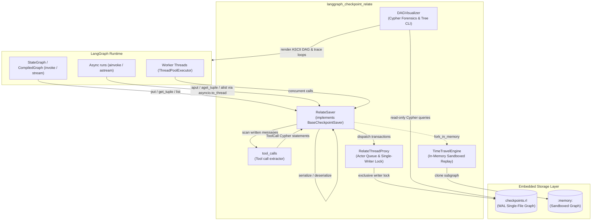
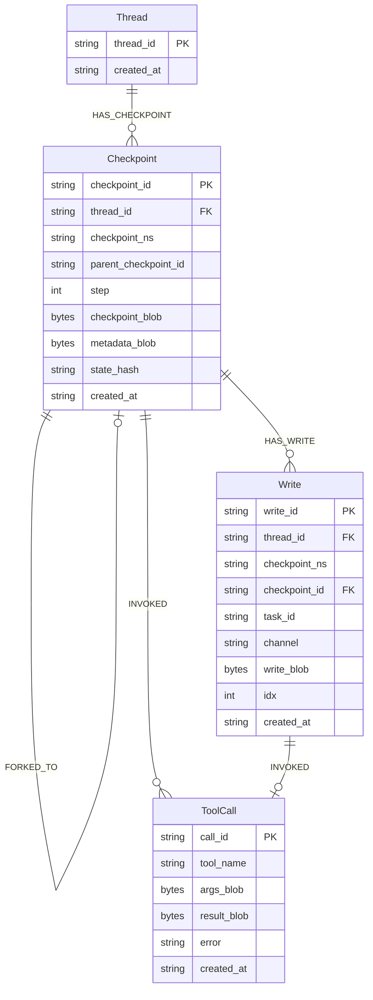
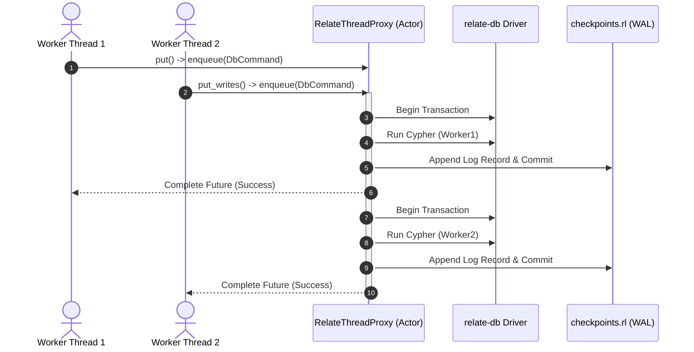

# System Architecture: RelateGraphSaver

Embedded graph-native checkpointing, thread-affinity serialization, and time-travel persistence architecture for LangGraph workflows.

Reference documents:
- [specification](SPEC.md)
- [decisions](DECISIONS.md)
- [overview](README.md)

Date: 2026-11-17  
Status: FROZEN

---

## Overview

RelateGraphSaver provides an embedded, graph-native checkpoint saver for LangGraph powered by the embedded Relate database engine from Neo4j. It eliminates the need for external database servers (e.g., PostgreSQL or Neo4j server daemons) by persisting agent execution state into a single local file (`.rl`) backed by Write-Ahead Logging (WAL). Workflows, branching paths, tool executions, and pending writes are mapped directly to a directed property graph. A dedicated actor queue (`RelateThreadProxy`) handles thread affinity and guarantees serialized write access across concurrent worker threads, while `TimeTravelEngine` enables zero-cleanup in-memory branching replays, and `DAGVisualizer` provides terminal-native Cypher diagnostics. Tool calls made by the model during a real run are captured from the persisted LangChain messages into `:ToolCall` nodes, so root-cause analysis works on data the run itself produced ([ADR-0005](DECISIONS.md#adr-0005-capture-tool-calls-from-persisted-langchain-messages)). Async graph execution (`ainvoke`, `astream`) is supported by running the synchronous methods off the event loop ([ADR-0006](DECISIONS.md#adr-0006-async-checkpointer-methods-delegate-to-the-synchronous-methods-on-worker-threads)). Architectural rationale and alternatives are documented in [decisions](DECISIONS.md).

---

## Technology stack

- **Language:** Python 3.11+ (`requires-python = ">=3.11"`; developed and tested on 3.13)
- **Graph Database Engine:** `relate-db` (Embedded Neo4j-compatible Cypher engine with single-file WAL storage and in-memory `:memory:` URI support)
- **Agent Framework:** `langgraph-checkpoint >= 2.0.0`, `langgraph >= 0.2.0`, `langchain-core >= 0.2.0` (imported directly for `RunnableConfig` and message types; declared explicitly per [ADR-0009](DECISIONS.md#adr-0009-declare-every-directly-imported-runtime-dependency-and-prove-it-with-a-clean-install))
- **Serialization:** `langgraph.checkpoint.serde.jsonplus.JsonPlusSerializer`
- **Async:** standard library `asyncio` (`asyncio.to_thread`); no async database driver
- **CLI & Terminal UI:** `typer >= 0.12.0`, `click >= 8.1.0`, `rich >= 13.7.0`
- **Type Checking & Linting:** `mypy >= 1.11.0`, `ruff >= 0.6.0`
- **Testing Runner:** `pytest >= 8.3.0`, `pytest-mock >= 3.14.0`. Async tests call `asyncio.run(...)` inside ordinary test functions; no pytest async plugin is added.
- **Benchmark (dev only):** `langgraph-checkpoint-sqlite >= 2.0.0` in the `dev` extra, never in `[project].dependencies` ([ADR-0008](DECISIONS.md#adr-0008-standalone-benchmark-script-against-sqlitesaver))

---

## Test commands

All commands run from the repository root with the project virtual environment active (`source .venv/Scripts/activate` in Git Bash, `.venv\Scripts\Activate.ps1` in PowerShell). A globally installed `ruff` or `mypy` may be a different version and give different results.

### Full test command
Runs every automated test across unit, integration, and CLI suites, including `slow` tests:
```bash
python -m pytest -q
```
The slow clean-install test (AC-33) creates a fresh virtual environment and installs the package from the package index, so the full suite needs network access.

### Fast test command
Runs formatting checks, linter, static type checker, and all fast tests (excluding tests tagged with `@pytest.mark.slow`):
```bash
ruff check . && ruff format --check . && mypy src tests && python -m pytest -q -m "not slow"
```
All four steps exit 0 (AC-35, AC-36, AC-37, AC-38). `ruff` covers every Python file in the repository, including `benchmarks/` and `examples/`; `mypy` covers `src` and `tests` only. The mypy configuration that makes this possible is described in [ADR-0007](DECISIONS.md#adr-0007-static-quality-gates-pass-through-configuration-and-behavior-neutral-fixes).

### One file test command
Runs a targeted test file:
```bash
python -m pytest -q tests/unit/test_<module>.py
```

### Benchmark command (not a test)
```bash
python benchmarks/bench_checkpointers.py --checkpoints 1000
```
The benchmark is not collected by pytest (`testpaths = ["tests"]`, and the file is not named `test_*`). See [Benchmark](#benchmark).

*Note on test performance:* Tests that run full multi-agent simulation loops, process termination crash simulations, fresh-environment installs, or large graph workloads are marked `@pytest.mark.slow`. The fast suite completes in under 15 seconds.

---

## Components

The system is structured into deep modules with clear seams, high internal cohesion, and minimal surface area.



### Component Summary
- **`RelateSaver`:** Public adapter implementing LangGraph's `BaseCheckpointSaver` interface, handling serialization envelopes (`JsonPlusSerializer`), state versioning, high-level checkpointer semantics, and the async methods that delegate to the synchronous ones.
- **`tool_calls` (tool call extractor):** Pure functions that find AI tool calls and tool result messages in written values and turn them into idempotent `:ToolCall` Cypher statements. It never raises; malformed entries are skipped.
- **`RelateThreadProxy`:** Actor queue and thread-affinity broker running on a dedicated thread, serializing database write transactions and enforcing single-writer access to prevent thread-affinity exceptions and file lock collisions.
- **`TimeTravelEngine`:** In-memory replay controller that extracts execution subgraphs and clones them into isolated `:memory:` database instances for zero-side-effect what-if debugging.
- **`DAGVisualizer`:** Graph forensics and diagnostic renderer that executes Cypher path queries to produce Unicode execution trees, cycle detection reports, and failure root-cause traces.

---

## Graph schema and data models

### Graph Schema Overview

The execution history of LangGraph workflows is mapped directly to a directed property graph:



### Node Labels and Properties

#### 1. `:Thread`
Represents an isolated LangGraph execution thread.
- `thread_id` (String, Indexed, Unique): Unique identifier of the workflow execution thread.
- `created_at` (String, ISO-8601): Timestamp when the thread was first registered.

#### 2. `:Checkpoint`
Represents an immutable snapshot of state at a discrete workflow step.
- `checkpoint_id` (String, Indexed, Unique): Unique checkpoint identifier (UUID or ULID generated by LangGraph).
- `thread_id` (String, Indexed): Parent thread identifier.
- `checkpoint_ns` (String, default `""`): Subgraph namespace identifier for nested multi-agent workflows.
- `parent_checkpoint_id` (String, Nullable): ID of the preceding checkpoint.
- `step` (Integer): Monotonically increasing execution step counter.
- `checkpoint_blob` (Bytes): Serialized channel state and versions encoded via `JsonPlusSerializer`.
- `metadata_blob` (Bytes): Serialized step metadata (writes, node name, source step).
- `state_hash` (String, Indexed): SHA-256 hash of serialized state channels used for O(1) cycle and oscillation detection.
- `created_at` (String, ISO-8601): Commit timestamp.

#### 3. `:Write`
Represents pending channel updates or intermediate writes (such as human-in-the-loop pending actions).
- `write_id` (String, Indexed, Unique): Composite identifier (`{thread_id}:{checkpoint_ns}:{checkpoint_id}:{task_id}:{idx}`).
- `thread_id` (String): Associated thread identifier.
- `checkpoint_ns` (String): Associated namespace.
- `checkpoint_id` (String): Targeted checkpoint identifier.
- `task_id` (String): LangGraph task identifier that emitted the write.
- `channel` (String): State channel receiving the write.
- `write_blob` (Bytes): Serialized write value.
- `idx` (Integer): Zero-based sequence index within the task emission batch.
- `created_at` (String, ISO-8601): Write timestamp.

#### 4. `:ToolCall`
Represents one tool invocation requested by the model, written by `RelateSaver` from the LangChain messages of a real run ([ADR-0005](DECISIONS.md#adr-0005-capture-tool-calls-from-persisted-langchain-messages)). These are exactly the properties `forensics.py` reads; no other properties are written.

| Property | Type | Set when | Source |
| :--- | :--- | :--- | :--- |
| `call_id` | String, Unique | Node creation | `AIMessage.tool_calls[i]["id"]`, verbatim (no prefix) |
| `tool_name` | String | Node creation | `AIMessage.tool_calls[i]["name"]` |
| `args_blob` | Bytes | Node creation | `serde.dumps(tool_calls[i]["args"])`, the same `JsonPlusSerializer` envelope as `write_blob` |
| `result_blob` | Bytes, Nullable | First outcome, if not an error | `serde.dumps(ToolMessage.content)` |
| `error` | String, Nullable | First outcome, if `ToolMessage.status == "error"` | Error text (see [Tool call capture](#6-tool-call-capture-tool_callspy)) |
| `created_at` | String, ISO-8601 | Node creation | Timestamp of the save that first saw the call |

Validation and invariants:
- A tool call without a non-empty string `id` or `name` is skipped (AC-47).
- At most one of `result_blob` and `error` is ever set. The first outcome recorded wins; later outcome writes for the same `call_id` change nothing.
- Properties not yet known are absent (read back as null), never empty strings. Forensics treats `error IS NOT NULL AND error <> ''` as a failure.
- `call_id` is globally unique (existing `tool_call_id_unique` constraint). If two threads reuse the same id (typical only of hand-written fakes), they share one node; each thread still gets its own `[:INVOKED]` edge, and the first outcome wins. Real model providers generate unique ids; the demo and tests generate `call_<uuid4 hex>` ids.
- `ToolCallNode` in `models.py` already matches this shape and is unchanged.

### Relationship Types

- `(:Thread)-[:HAS_CHECKPOINT]->(:Checkpoint)`: Connects a thread to all checkpoints within its lineage.
- `(:Checkpoint)-[:NEXT]->(:Checkpoint)`: Direct causal edge linking step $N$ to step $N+1$ along the primary execution branch.
- `(:Checkpoint)-[:FORKED_TO]->(:Checkpoint)`: Branch edge linking a historical checkpoint to the root checkpoint of a branched or replayed thread.
- `(:Checkpoint)-[:HAS_WRITE]->(:Write)`: Links a checkpoint to its pending or committed writes.
- `(:Checkpoint)-[:INVOKED]->(:ToolCall)`: Links the checkpoint at which a thread first recorded a tool call to that call. For `put_writes()` this is the checkpoint named by `config["configurable"]["checkpoint_id"]` (the checkpoint the model's task ran from, AC-41); for `put()` it is the checkpoint being stored (AC-42). Exactly one such edge exists per (thread, `call_id`): a later save in the same thread that sees the same call adds no edge. In a normal LangGraph run the model's write arrives through `put_writes()` first, so the edge attaches to the checkpoint the model step ran from.
- `(:Write)-[:INVOKED]->(:ToolCall)`: Reserved. The saver does not write this edge; forensics reads it if present, so existing data that contains it keeps working.

### Cypher DDL Constraints and Indexes

Initialized automatically on database creation (unchanged):
```cypher
CREATE CONSTRAINT thread_id_unique IF NOT EXISTS
FOR (t:Thread) REQUIRE t.thread_id IS UNIQUE;

CREATE CONSTRAINT checkpoint_id_unique IF NOT EXISTS
FOR (c:Checkpoint) REQUIRE c.checkpoint_id IS UNIQUE;

CREATE CONSTRAINT write_id_unique IF NOT EXISTS
FOR (w:Write) REQUIRE w.write_id IS UNIQUE;

CREATE CONSTRAINT tool_call_id_unique IF NOT EXISTS
FOR (tc:ToolCall) REQUIRE tc.call_id IS UNIQUE;

CREATE INDEX checkpoint_thread_idx IF NOT EXISTS
FOR (c:Checkpoint) ON (c.thread_id, c.checkpoint_ns, c.step);

CREATE INDEX checkpoint_hash_idx IF NOT EXISTS
FOR (c:Checkpoint) ON (c.state_hash);
```

---

## Interfaces and contracts

### 1. `RelateSaver` Interface

`RelateSaver` inherits from `langgraph.checkpoint.base.BaseCheckpointSaver` and implements the synchronous checkpoint operations plus their async counterparts. Existing synchronous signatures and return values are unchanged; `put()` and `put_writes()` additionally capture tool calls after the checkpoint or writes are committed.

```python
from collections.abc import AsyncIterator, Iterator, Sequence
from typing import Any
from langgraph.checkpoint.base import (
    BaseCheckpointSaver,
    Checkpoint,
    CheckpointMetadata,
    CheckpointTuple,
    ChannelVersions,
)
from langchain_core.runnables import RunnableConfig

class RelateSaver(BaseCheckpointSaver[str]):
    def __init__(
        self,
        db_path: str | RelateThreadProxy = ":memory:",
        *,
        wal_enabled: bool = True,
        proxy: RelateThreadProxy | None = None,
        serde: RelateStateSerializer | SerializerProtocol | None = None,
        connection_factory: Any | None = None,
    ) -> None: ...

    # --- synchronous (unchanged signatures) ---
    def put(self, config: RunnableConfig, checkpoint: Checkpoint,
            metadata: CheckpointMetadata, new_versions: ChannelVersions) -> RunnableConfig:
        """Persist a checkpoint node, connect NEXT/FORKED_TO, then capture tool calls
        found in checkpoint["channel_values"] (AC-42)."""
    def put_writes(self, config: RunnableConfig, writes: Sequence[tuple[str, Any]],
                   task_id: str, task_path: str = "") -> None:
        """Store pending writes linked via HAS_WRITE, then capture tool calls found in
        the written values (AC-41)."""
    def get_tuple(self, config: RunnableConfig) -> CheckpointTuple | None: ...
    def list(self, config: RunnableConfig | None, *, filter: dict[str, Any] | None = None,
             before: RunnableConfig | None = None, limit: int | None = None
             ) -> Iterator[CheckpointTuple]: ...
    def fork_in_memory(self, thread_id: str, checkpoint_id: str) -> "RelateSaver": ...
    def detect_loops(self, thread_id: str, threshold: int = 2) -> list["LoopReport"]: ...
    def trace_root_cause(self, thread_id: str) -> "RootCauseReport": ...
    def close(self) -> None: ...

    # --- async (new) ---
    async def aget_tuple(self, config: RunnableConfig) -> CheckpointTuple | None: ...
    async def alist(self, config: RunnableConfig | None, *, filter: dict[str, Any] | None = None,
                    before: RunnableConfig | None = None, limit: int | None = None
                    ) -> AsyncIterator[CheckpointTuple]: ...
    async def aput(self, config: RunnableConfig, checkpoint: Checkpoint,
                   metadata: CheckpointMetadata, new_versions: ChannelVersions) -> RunnableConfig: ...
    async def aput_writes(self, config: RunnableConfig, writes: Sequence[tuple[str, Any]],
                          task_id: str, task_path: str = "") -> None: ...
```

#### Async method contract
- Each async method is `await asyncio.to_thread(<sync method>, <same arguments>)`. `alist` runs `list(self.list(config, filter=filter, before=before, limit=limit))` in one `to_thread` call, then yields the materialized tuples in order.
- Results equal the synchronous counterpart for the same inputs (AC-50); errors are the same exception types, raised from the `await`.
- The synchronous method never runs on the event loop thread (AC-54). Writes still go through `RelateThreadProxy`, so ordering and single-writer guarantees are identical to synchronous use.
- Cancelling the awaiting task does not abort a write already handed to a worker thread; the write completes and is committed.
- `delete_thread` / `adelete_thread`: `RelateSaver` defines neither, so the base-class behavior stays (AC-55). If a synchronous `delete_thread` is added later, `adelete_thread` must be added in the same change as `asyncio.to_thread(self.delete_thread, thread_id)`.
- Rationale and rejected options: [ADR-0006](DECISIONS.md#adr-0006-async-checkpointer-methods-delegate-to-the-synchronous-methods-on-worker-threads).

#### Tool call capture inside `put()` and `put_writes()`
- `put_writes()`: after its existing `execute_batch` succeeds, calls the private helper `_capture_tool_calls(values=[value for _, value in writes], thread_id=thread_id, checkpoint_id=checkpoint_id_str)`.
- `put()`: after its existing `execute_write` succeeds, calls `_capture_tool_calls(values=checkpoint["channel_values"].values(), thread_id=thread_id, checkpoint_id=checkpoint_id)` when `channel_values` is a dict; otherwise does nothing.
- `_capture_tool_calls` builds statements with the [tool call extractor](#6-tool-call-capture-tool_callspy) and, if there are any, submits them with one `self.proxy.execute_batch(statements)`. It catches every `Exception`, logs at WARNING with the checkpoint id and the exception class name only (never argument or result content), and returns normally. Tool call capture can never make `put()` or `put_writes()` raise or roll back (AC-47).
- No messages in the values means no statements, no `:ToolCall` nodes and no `[:INVOKED]` edges (AC-46).

### 2. `RelateThreadProxy` Actor Protocol

Embedded databases require strict thread affinity for file writing. The `RelateThreadProxy` encapsulates all direct database driver calls inside an isolated worker actor thread. Its interface is unchanged; tool call capture and the async methods only add callers.

```python
import concurrent.futures
from dataclasses import dataclass
from typing import Any

@dataclass(frozen=True)
class DbCommand:
    cypher: str
    params: dict[str, Any]
    is_write: bool
    future: concurrent.futures.Future[Any]

class RelateThreadProxy:
    def __init__(self, db_path: str, wal_enabled: bool = True) -> None: ...
    def execute_write(self, cypher: str, params: dict[str, Any]) -> Any: ...
    def execute_read(self, cypher: str, params: dict[str, Any]) -> Any: ...
    def execute_batch(self, statements: list[tuple[str, dict[str, Any]]]) -> list[Any]:
        """Run all statements in one transaction; all commit or all roll back."""
    def stop(self) -> None: ...
```

Callers on any thread (LangGraph worker threads, `asyncio.to_thread` workers) block on the command future; the proxy's single worker thread is the only thread that touches the driver.

### 3. Forensic Data Models

```python
from dataclasses import dataclass

@dataclass(frozen=True)
class LoopReport:
    thread_id: str
    cycle_nodes: list[str]
    occurrence_count: int
    checkpoint_id_range: tuple[str, str]

@dataclass(frozen=True)
class RootCauseReport:
    thread_id: str
    error_checkpoint_id: str
    error_message: str
    root_tool_call_id: str | None = None
    root_channel_write: str | None = None
    causal_path_length: int = 0
    diagnostic_summary: str = ""
    root_tool_name: str | None = None   # new, last field, default None
```

`root_tool_name` is added so the report can name the failing tool by `tool_name` and `call_id` (AC-45). It is the last field with a default, so existing positional and keyword construction keeps working. `trace_root_cause()` sets it from the `tool_name` column of the same causal-query row that supplies `root_tool_call_id`, in every priority branch that sets `root_tool_call_id`. When it is set, the diagnostic summary appends one sentence, `Failing tool: '<tool_name>'.`, after the existing `Root tool invocation: '<call_id>'.` sentence; all existing sentences are unchanged.

### 4. CLI Command Interface (`relate-dag`)

The CLI provides an interactive terminal interface for workflow exploration:

- **`relate-dag tree <thread_id> [--file <path>]`**
  Renders a Unicode DAG tree of checkpoints, branching points, and status tags (`[PENDING]`, `[ERROR]`, `[OK]`).
- **`relate-dag replay <thread_id> --checkpoint <id> [--edit <json>]`**
  Spawns an interactive in-memory replay session starting from the specified checkpoint.
- **`relate-dag forensics loops <thread_id> [--threshold <int>]`**
  Queries the Cypher graph for repeating state transitions and displays cycle tables.
- **`relate-dag forensics trace-error <thread_id>`**
  Traverses backward causal paths to print root-cause analysis for failed threads. The report panel gains a `Root Tool Name:` line (shows `None` when unknown) next to `Root Tool Call ID:`.

`relate-dag --help` must work in a fresh environment with only the declared dependencies installed (AC-33).

### 5. In-Memory Fakes for Testing

To ensure ultra-fast unit testing without disk I/O, the suite includes an in-memory seam fake:

```python
class InMemoryRelateDriver:
    """In-memory dictionary/graph fake mimicking relate-db Cypher engine."""
    def __init__(self) -> None:
        self.nodes: dict[str, dict[str, Any]] = {}
        self.edges: list[tuple[str, str, str]] = []

    def run(self, query: str, parameters: dict[str, Any] | None = None) -> list[dict[str, Any]]:
        ...
```

The fake's pattern matching does not cover the tool call Cypher. Tool call extraction is tested as pure functions; tool call persistence, forensics and async tests run against real `relate-db` `:memory:` databases, like the existing integration tests.

### 6. Tool call capture (`tool_calls.py`)

A small module with no database access, so parsing and statement building are tested without a saver ([ADR-0005](DECISIONS.md#adr-0005-capture-tool-calls-from-persisted-langchain-messages)).

```python
from collections.abc import Iterable
from dataclasses import dataclass
from typing import Any, Protocol

class BlobSerializer(Protocol):
    def dumps(self, obj: Any) -> bytes: ...

@dataclass(frozen=True)
class ToolInvocation:
    call_id: str
    tool_name: str
    args: Any

@dataclass(frozen=True)
class ToolOutcome:
    call_id: str
    is_error: bool
    content: Any

@dataclass(frozen=True)
class ToolEvents:
    invocations: tuple[ToolInvocation, ...]
    outcomes: tuple[ToolOutcome, ...]

def extract_tool_events(values: Iterable[Any]) -> ToolEvents:
    """Never raises. Collects tool calls and tool results from written values."""

def build_tool_call_statements(
    events: ToolEvents, *, thread_id: str, checkpoint_id: str,
    serde: BlobSerializer, created_at: str,
) -> list[tuple[str, dict[str, Any]]]:
    """Invocation statements first, then outcome statements."""
```

**Message discovery** (`extract_tool_events`), applied to each value independently:
- A value that is a `langchain_core.messages.BaseMessage` is a one-message list. A `list` or `tuple` value contributes its elements that are `BaseMessage` instances; other elements (dicts, strings, `None`) are skipped (AC-47). Any other value (dict, scalar, `None`) contributes nothing. Values are not searched recursively. Channel names are not inspected.
- `AIMessage` (including `AIMessageChunk`): each entry of `.tool_calls` becomes a `ToolInvocation(call_id=entry["id"], tool_name=entry["name"], args=entry.get("args", {}))`. Entries whose `id` or `name` is missing, empty, or not a string are skipped. `invalid_tool_calls` are ignored.
- `ToolMessage`: becomes `ToolOutcome(call_id=msg.tool_call_id, is_error=(msg.status == "error"), content=msg.content)`. A missing or empty `tool_call_id` is skipped.
- Every other message type is ignored. Each value and each message is processed inside its own `try`/`except Exception`, so one bad entry never hides the others.
- Duplicates within one call are removed by `call_id`, keeping the first invocation and the first outcome.

**Statements** (`build_tool_call_statements`). Serialization failure for one invocation or outcome skips that entry only. Parameters are `call_id`, `tool_name`, `args_blob`, `created_at`, `thread_id`, `checkpoint_id`, and `result_blob` or `error`.

Invocation (one per `ToolInvocation`, AC-41, AC-42, AC-48):
```cypher
MERGE (tc:ToolCall {call_id: $call_id})
ON CREATE SET tc.tool_name = $tool_name, tc.args_blob = $args_blob, tc.created_at = $created_at
WITH tc
OPTIONAL MATCH (c:Checkpoint {checkpoint_id: $checkpoint_id})
OPTIONAL MATCH (linked:Checkpoint {thread_id: $thread_id})-[:INVOKED]->(tc)
WITH tc, c, count(linked) AS linked_count
FOREACH (_ IN CASE WHEN c IS NOT NULL AND linked_count = 0 THEN [1] ELSE [] END |
  MERGE (c)-[:INVOKED]->(tc))
```

Successful outcome (AC-43, AC-49):
```cypher
MATCH (tc:ToolCall {call_id: $call_id})
WHERE tc.result_blob IS NULL AND tc.error IS NULL
SET tc.result_blob = $result_blob
```

Error outcome (AC-44, AC-49):
```cypher
MATCH (tc:ToolCall {call_id: $call_id})
WHERE tc.result_blob IS NULL AND tc.error IS NULL
SET tc.error = $error
```

- `result_blob = serde.dumps(content)`.
- `error`: `content` if it is a non-empty string; if it is a list, the `str` items and the `"text"` values of dict items joined with newlines; otherwise `str(content)`. If the result is empty, the text is `Tool call returned status 'error' with no message`.
- `MATCH` (not `MERGE`) means an orphan result creates nothing (AC-49). Invocation statements come before outcome statements in the batch, so a tool call and its result found in the same `put()` both land in one pass.

### 7. Tool-calling demo (`examples/tool_agent.py`)

The existing `examples/research_agent.py` has no messages or tools and stays unchanged. AC-45 runs against a separate, key-free demo:
- `create_tool_agent_graph(checkpointer: BaseCheckpointSaver | None = None) -> CompiledStateGraph` on `MessagesState`: `START -> agent`, `agent -> tools` when the last AI message has tool calls (else `END`), `tools -> agent`.
- `agent` is a deterministic function, not an LLM: on the first turn it returns an `AIMessage` with one tool call `{"name": "fetch_source", "args": {"url": ...}, "id": "call_<uuid4 hex>"}`; after a `ToolMessage` it returns a final `AIMessage` without tool calls.
- `tools` is `langgraph.prebuilt.ToolNode([fetch_source], handle_tool_errors=True)`. `fetch_source` raises `RuntimeError` when the demo runs in failing mode (default), so `ToolNode` emits a `ToolMessage` with `status="error"` and `graph.invoke` completes normally.
- `run_tool_agent(saver: RelateSaver, thread_id: str, *, fail: bool = True) -> dict[str, Any]` runs `graph.invoke` and returns the final state. A `main()` with `--db` and `--thread-id` mirrors `research_agent.py`.

---

## Concurrency and crash safety model

### Thread Affinity and Actor Queue



1. **Serialized Writes:** All mutating operations (`put`, `put_writes`, tool call capture, `fork`) pass through the `RelateThreadProxy` command queue. The proxy executes strictly on a single dedicated background thread, eliminating DB-API thread-affinity violations and file-lock collisions.
2. **Crash Resilience:** Every commit flushes through the Write-Ahead Log before acknowledging caller futures. If the host process crashes mid-step, uncommitted transactions are rolled back during WAL recovery on restart, guaranteeing zero orphaned nodes or dangling edges. Measured cost: in relate-db 1.0 each flush takes time proportional to the database file size, so with the default `wal_enabled=True` save latency grows as a thread's history grows (about 25 ms per save early and about 110 ms after 1,000 checkpoints in our benchmark). `wal_enabled=False` skips only the per-write flush and keeps saves flat (about 3 ms); a process kill still kept committed checkpoints in our tests, but durability across power loss without the flush is not verified, and the file grows larger. We keep the flush as the default.
3. **Deadlock Prevention:** Calling threads wait synchronously on lightweight `concurrent.futures.Future` objects with configurable timeout guards. Reads and writes cannot interleave within an active atomic transaction.

### Tool call capture ordering

`put()` and `put_writes()` make two proxy submissions: first the existing checkpoint or write transaction, then, only if it committed, one transaction with the tool call statements. Another thread's command may run between the two; this is harmless because every tool call statement is idempotent and evaluates its edge condition inside its own transaction. A crash between the two submissions leaves a committed checkpoint without its `:ToolCall` nodes. The next `put()` in that thread rescans the accumulated message history in `channel_values` and records the missing calls, attaching `[:INVOKED]` to that later checkpoint.

### Async execution

```mermaid
sequenceDiagram
    participant Loop as Event loop (ainvoke / astream)
    participant Pool as asyncio default executor thread
    participant Saver as RelateSaver (sync method)
    participant Proxy as RelateThreadProxy (Actor)

    Loop->>Pool: await asyncio.to_thread(saver.put, ...)
    Pool->>Saver: put(...)
    Saver->>Proxy: execute_write / execute_batch (blocks on Future)
    Proxy-->>Saver: Future result
    Saver-->>Pool: RunnableConfig
    Pool-->>Loop: resume coroutine
```

- The event loop never blocks on database work. Concurrent `asyncio.gather` runs on distinct thread_ids (AC-53) occupy at most the default executor's worker count (`min(32, cpu_count + 4)`); beyond that, calls queue in the executor.
- The proxy remains the single writer, so async and sync callers can share one `RelateSaver` safely.
- `RELATE_PROXY_TIMEOUT_SEC` applies unchanged; a timeout surfaces as `RelateConcurrencyError` from the `await`.

---

## Benchmark

`benchmarks/bench_checkpointers.py` compares `RelateSaver` with `SqliteSaver` on the same workload ([ADR-0008](DECISIONS.md#adr-0008-standalone-benchmark-script-against-sqlitesaver)). It is a standalone script, not part of either pytest suite, and the README publishes its output as measured (AC-58), whichever saver is faster.

**Invocation:** `python benchmarks/bench_checkpointers.py [--checkpoints N] [--payload-bytes B] [--seed S] [--workdir DIR]`. Defaults: `N=200`, `B=256`, `S=0`, `DIR` = a temporary directory deleted at exit. Exit codes: `0` success; `1` if the two savers return different ancestry counts; `2` if `langgraph-checkpoint-sqlite` is not installed (the message says to install the `dev` extra).

**Workload (identical for every run):** file-backed databases in `DIR` (`relate.rl`, `relate-noflush.rl`, `sqlite.db`). RelateSaver runs twice, with the default per-write flush and with `wal_enabled=False`, reported as separate columns. One thread_id; a main chain of N checkpoints where each `put()` receives the config returned by the previous one; channel values `{"step": i, "payload": "x" * B}` with no LangChain messages (so tool call capture adds only its scan); checkpoint ids from `langgraph.checkpoint.base.id.uuid6()`, as LangGraph itself uses. After the timed chain, an untimed branch of `max(1, N // 10)` checkpoints is written from the checkpoint at index `N // 2`. `SqliteSaver` is built as `SqliteSaver(sqlite3.connect(path, check_same_thread=False))` followed by `setup()`.

| Metric | Unit | How it is measured |
| :--- | :--- | :--- |
| Put throughput | checkpoints/s | N divided by the `time.perf_counter()` wall time of the N main-chain `put()` calls |
| Get latency | ms, p50 and p95 | `min(N, 200)` `get_tuple()` calls for checkpoint ids drawn with `random.Random(S)` from the written set, each timed individually |
| On-disk size | KiB | After the saver and connection are closed: total size of the database file plus every sidecar file sharing its name prefix (WAL, shared-memory) |
| Ancestry query | ms, median of 5 | All ancestors of the branch leaf back to the root. Relate: one Cypher query over `[:NEXT\|FORKED_TO*0..]`, anchored on the leaf (`(leaf {checkpoint_id})<-[...*0..]-(a)`), through `saver.proxy.execute_read`. The anchor matters: in relate-db 1.0 the unanchored direction expands from every checkpoint and took about 2.3 s at N=1000 against about 9 ms anchored. `trace_root_cause` uses the same anchored shape. SQLite: one `WITH RECURSIVE` query over the `checkpoints` table's `parent_checkpoint_id` column. Both must return `N // 2 + 1 + max(1, N // 10)` checkpoints. |

**Output:** stdout carries only Markdown: an environment block (N, B, OS, CPU from `platform.processor()`, Python version, and the installed versions of `relate-db`, `langgraph-checkpoint`, `langgraph-checkpoint-sqlite` and SQLite) followed by one table with the columns `Metric | RelateSaver | SqliteSaver` and one row per figure (put throughput, get p50, get p95, on-disk size, ancestry query). Progress goes to stderr.

---

## Directory layout

```
RelateGraphSaver/
├── .env.example
├── pyproject.toml
├── README.md                   # includes "How we use Relate, and why" and benchmark results
├── docs/
│   ├── ARCHITECTURE.md
│   ├── DECISIONS.md
│   ├── README.md
│   └── SPEC.md
├── src/
│   └── langgraph_checkpoint_relate/
│       ├── __init__.py
│       ├── cli.py              # CLI entry point (relate-dag)
│       ├── errors.py           # Custom exception taxonomy
│       ├── forensics.py        # Cypher loop & root-cause queries
│       ├── models.py           # DTOs and report data structures
│       ├── proxy.py            # RelateThreadProxy actor implementation
│       ├── saver.py            # RelateSaver (BaseCheckpointSaver, sync + async)
│       ├── schema.py           # Cypher constraints and schema migrations
│       ├── serde.py            # JsonPlusSerializer wrapper & error mapper
│       ├── time_travel.py      # TimeTravelEngine in-memory sandbox
│       ├── tool_calls.py       # NEW: tool call extractor and ToolCall statements
│       └── visualizer.py       # Rich/Unicode tree terminal renderer
├── tests/                      # no __init__.py here (see ADR-0007)
│   ├── conftest.py             # Shared fixtures and in-memory fakes
│   ├── unit/
│   │   ├── test_errors.py
│   │   ├── test_models.py
│   │   ├── test_packaging.py   # + declared-dependency checks (AC-34, AC-57)
│   │   ├── test_proxy.py
│   │   ├── test_saver.py
│   │   ├── test_serde.py
│   │   ├── test_tool_calls.py  # NEW: extractor and statement builder (AC-46, AC-47)
│   │   └── test_visualizer.py
│   ├── integration/
│   │   ├── test_async_saver.py         # NEW: AC-50..AC-55
│   │   ├── test_clean_install.py       # NEW, slow: AC-33
│   │   ├── test_cli.py
│   │   ├── test_concurrency.py
│   │   ├── test_crash_recovery.py
│   │   ├── test_forensics.py
│   │   ├── test_langgraph_workflow.py
│   │   ├── test_m1_milestone.py
│   │   ├── test_m2_milestone.py
│   │   ├── test_m3_milestone.py
│   │   ├── test_time_travel.py
│   │   ├── test_tool_call_capture.py   # NEW: AC-41..AC-44, AC-46..AC-49
│   │   └── test_tool_forensics_demo.py # NEW: AC-45 via examples/tool_agent.py
│   └── fakes/
│       ├── __init__.py
│       └── fake_relate_driver.py
├── benchmarks/
│   └── bench_checkpointers.py  # NEW: RelateSaver vs SqliteSaver (not a test)
└── examples/
    ├── research_agent.py       # Multi-agent demo workflow (unchanged)
    └── tool_agent.py           # NEW: key-free tool-calling demo for forensics
```

---

## Configuration

Configuration parameters can be supplied directly to `RelateSaver` or read from environment variables. No new variables are added; the benchmark takes command-line arguments only.

| Environment Variable | Type | Default | Description |
| :--- | :--- | :--- | :--- |
| `RELATE_DB_PATH` | string | `"checkpoints.rl"` | Default file path for durable embedded graph storage |
| `RELATE_WAL_ENABLED` | boolean | `true` | Enables the per-write WAL flush for crash safety (see the measured cost under the concurrency and crash safety model) |
| `RELATE_PROXY_TIMEOUT_SEC` | float | `30.0` | Maximum wait time for actor queue transactions before raising timeout |
| `RELATE_LOG_LEVEL` | string | `"INFO"` | Logging verbosity (`DEBUG`, `INFO`, `WARNING`, `ERROR`) |

---

## Setup requirements

### Tools
| Tool | Minimum Version | Verification Command | Notes |
| :--- | :--- | :--- | :--- |
| Python | 3.11 | `python --version` | Package requires 3.11+; developed on 3.13 |
| pip | 24.0+ | `python -m pip --version` | Standard Python package installer |
| git | 2.40+ | `git --version` | Version control |
| Project virtual environment | n/a | `.venv/Scripts/python -m pip show langgraph-checkpoint-relate` | Create with `python -m venv .venv`, then `.venv/Scripts/python -m pip install -e ".[dev]"` (`.venv/bin/python` on macOS/Linux). The `dev` extra brings pytest, ruff, mypy and `langgraph-checkpoint-sqlite`. |

### Accounts and credentials
None. The RelateGraphSaver engine operates completely in-process as an embedded system. It requires no external cloud accounts, SaaS API tokens, or paid credentials. The tool-calling demo uses a deterministic agent function, not a model API.

### Local services
None. All graph storage is managed in-process via single-file `.rl` databases or `:memory:` targets. No Docker containers, PostgreSQL servers, or background daemon services are required. Network access to the package index is needed only for the slow clean-install test.

---

## Expensive to change

The following architectural choices are costly to alter post-implementation:

1. **Graph Schema and Relationship Taxonomy:**
   - *Components:* `(:Thread)`, `(:Checkpoint)`, `(:Write)`, `(:ToolCall)` and edges `[:NEXT]`, `[:FORKED_TO]`, `[:HAS_WRITE]`, `[:INVOKED]`.
   - *Why expensive:* Changing node labels or relationship semantics breaks all historical Cypher queries used by `DAGVisualizer`, loop detection, and root-cause analysis, and requires physical database schema migrations.
2. **Binary State Serialization Protocol:**
   - *Components:* `JsonPlusSerializer` envelope stored in `checkpoint_blob`, `write_blob`, `args_blob` and `result_blob`.
   - *Why expensive:* Blobs are written immutably to disk. Modifying the serialization format invalidates previously written checkpoints and tool calls and risks breaking deserialization of complex types (e.g., Pydantic models, LangChain messages).
3. **Actor Concurrency Model (`RelateThreadProxy`):**
   - *Components:* Single-writer actor queue dispatch, now also used by tool call capture and async callers.
   - *Why expensive:* Multi-threaded and async LangGraph executions rely on this boundary to avoid engine crashes and file lock collisions. Replacing it with connection pooling or multi-process sharing would require fundamental rewrites of transaction lifecycle management.
4. **LangGraph BaseCheckpointSaver Seam:**
   - *Components:* Method signatures and return structures (`put`, `put_writes`, `get_tuple`, `list`, `aput`, `aput_writes`, `aget_tuple`, `alist`).
   - *Why expensive:* Direct contract adherence to LangGraph's runtime is necessary for plug-and-play compatibility across all LangGraph graphs, subgraphs, and human-in-the-loop constructs, synchronous or async.
5. **Persisted `:ToolCall` property names and meaning:**
   - *Components:* `call_id`, `tool_name`, `args_blob`, `result_blob`, `error`, `created_at`, written by real runs ([ADR-0005](DECISIONS.md#adr-0005-capture-tool-calls-from-persisted-langchain-messages)).
   - *Why expensive:* Until now only tests created these nodes; from this release users' `.rl` files contain them and `forensics.py` reads them by name. Renaming a property, storing `error` as a blob, or adding a second outcome field needs a data migration and a forensics change together.
6. **`call_id` is the provider's tool call id, verbatim and globally unique:**
   - *Components:* `tool_call_id_unique` constraint, `MERGE` on `call_id`, `ToolMessage.tool_call_id` matching.
   - *Why expensive:* Moving to thread-scoped keys later (for example `{thread_id}:{call_id}`) would change the constraint, every stored node, and what `root_tool_call_id` reports to users.
7. **Tool call recording rules:**
   - *Components:* one `[:INVOKED]` edge per (thread, call) from the first checkpoint that saw the call; first outcome wins; orphan results create nothing.
   - *Why expensive:* Forensics picks the error checkpoint from where the `[:INVOKED]` edge attaches. Changing which checkpoint gets the edge, or allowing outcomes to be overwritten, changes the reports of already stored runs.
8. **`RootCauseReport.root_tool_name`:**
   - *Components:* public dataclass field and the `Failing tool:` summary sentence.
   - *Why expensive:* It is public API; removing or renaming it breaks callers of `trace_root_cause()`.
